# irDashies - Real-time Racing Overlays

<div align="center" style="padding-bottom: 20px;">
  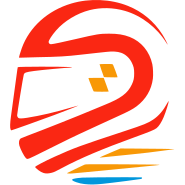

**[www.irdashies.com](https://www.irdashies.com)**

</div>

An open-source platform for building real-time racing overlays and utilities using React and Electron, with iRacing support and beta support for Le Mans Ultimate. Designed to be approachable for web developers — no iRacing SDK, C++, or simulator installation required to get started.

For bug reports, feature requests, or to get involved, join our [Discord](https://discord.gg/YMAqduF2Ft).

## Try it out

You can try it out by downloading the latest release from the [releases page](https://github.com/tariknz/irdashies/releases).

Install the Windows .exe and run it. The application will automatically update when a new version is available. For overlays to appear over the simulator, use windowed or borderless mode.

## Table of Contents

- [Introduction](#introduction)
- [Supported simulators](#supported-simulators)
- [Available overlays](#available-overlays)
- [Prerequisites](#prerequisites-for-development)
- [Installation](#installation-for-development)
- [Usage](#usage-for-development)
- [Folder Structure](#folder-structure)
- [Storybook](#storybook)
- [Package (create .exe)](#package-create-exe)
- [Testing](#testing)
- [Linting](#linting)
- [Developing on Mac](#developing-on-mac)
- [Sponsors](#sponsors)
- [Acknowledgments](#acknowledgments)
- [Contributing](#contributing)
- [License](#license)

## Introduction

This project is built with React and Electron and retrieves live telemetry from iRacing and Le Mans Ultimate to power configurable overlays and race utilities.

See the [latest release notes](https://github.com/tariknz/irdashies/releases/latest) for the latest updates.

## Supported simulators

iRacing is the primary supported simulator. Le Mans Ultimate support is in beta as of [v2.0.0](https://github.com/tariknz/irdashies/releases/tag/v2.0.0), with a limited set of supported widgets.

Choose **Auto**, **iRacing**, or **Le Mans Ultimate** in **Settings > General > Simulator**. Auto detects the running simulator and follows simulator changes without restarting irDashies. If both simulators are active when detection runs, iRacing takes priority; select Le Mans Ultimate explicitly if needed. Unsupported widgets are hidden for the active simulator.

### Le Mans Ultimate setup and limitations

1. In LMU, enable **Settings > Gameplay > Enable Plugins**, then restart the simulator.
2. Start irDashies and load into an LMU session to receive telemetry.

**Supported overlays:** Standings, Relative, Input, Lap Trace, Pitlane Helper, Corner Names, Battle, Flag, and Information Bar. Telemetry Inspector is also available for diagnostics. All other widgets are currently unavailable in LMU, including Fuel Calculator, both track maps, Radar, Gantry, Car Systems, Lap Timer, Tachometer, and Shift Light.

- Standings use class colours and manufacturer badges, with best-lap ordering in practice and position ordering in races. Driver ratings, incident counts, and team data are not yet integrated; car numbers are placeholders, and iRacing rating columns are hidden.
- Corner Names and Lap Trace corner feedback depend on available LMU track data. Unnamed turns use turn numbers where provided.
- Lap Trace does not yet check LMU lap validity, so laps invalidated by track limits may still become saved references. Imports support iRacing `.ibt` files and Garage 61 CSV laps, with no native LMU telemetry-file import.
- Input and Lap Trace need your own car's telemetry, which can be unavailable while spectating or in the garage.
- Lap positions are estimated between updates; cars without full telemetry may update in larger steps. Automatic units are metric, and Pitlane Helper currently uses a fixed 60 km/h pit limit.
- LMU in-game replays do not yet have iRacing's replay-aware handling. LMU session recording and playback tools are development tools.

## Available overlays

The features below describe iRacing support. See [Supported simulators](#supported-simulators) for LMU availability and limitations.

Screenshots show example layouts. Each widget's appearance and visible information can be configured in Settings.

### Input trace

Displays the throttle, clutch, and brake input traces, as well as the current gear and speed.

**Features:**

- Input trace visualization (throttle, brake, ABS indicator, steering)
  - Configurable stroke width (1-10px)
  - Configurable max samples (50-1000)
  - Toggle individual inputs (throttle, brake, ABS, steering)
  - ABS activity shown as an overlay or highlighted fill beneath the brake trace
- Input bar display (clutch, brake, throttle, ABS indicator)
  - Toggle individual inputs (clutch, brake, throttle, ABS)
  - Optional raw input values showing actual pedal/wheel inputs without sim processing (e.g. ABS, traction control)
- Current gear display with speed (auto/mph/km/h units) and dynamic sizing to fit container
- Optional speed-first gear layout
- Steering wheel visualization with multiple styles (default, formula, LMP, NASCAR, U-shape, ring) and color themes (light/dark)
- Customizable display order for all components
- Drag-and-drop layout editor to arrange traces, bars, steering, gear, and ABS indicators
- Multiple Input widgets with independent layouts, including a gear-only layout for a detached gear indicator
- Optional background shift flash at redline or custom Tachometer shift points, with a configurable colour
- Adjustable background opacity
- Option to show only when on track
- Session visibility settings (Race, Lone Qualify, Open Qualify, Practice, Offline Testing)

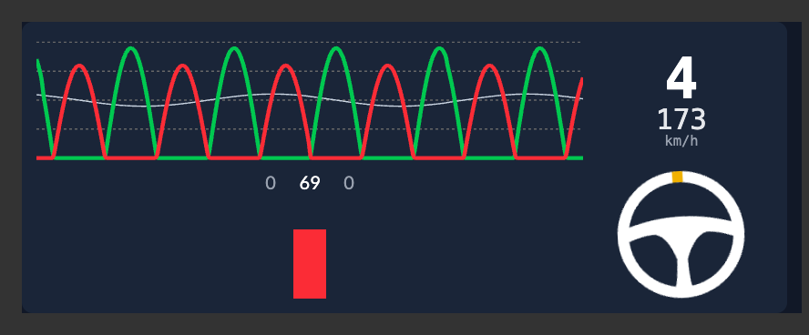

### Lap Trace

Compares your current lap against a saved reference to show where you gain or lose time.

**Features:**

- Automatically saves the fastest reference lap for each car and track, with clean-lap checks in iRacing
- Import reference laps from iRacing `.ibt` telemetry files or Garage 61 CSV laps
- Compare throttle, braking, and gear changes against the reference, with ABS activity where available
- Configurable audio or visual countdowns to reference braking points, with audio-device selection and a minimum brake-pressure filter
- Corner feedback showing time gained or lost, braking distance, and minimum speed where corner data is available

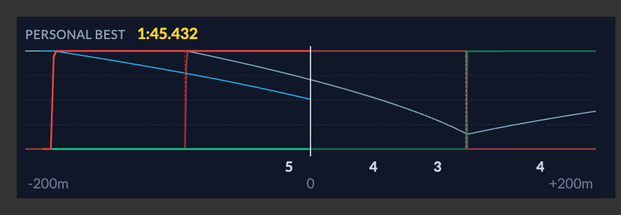

### Tachometer

Displays a real-time tachometer with optional RPM text display.

**Features:**

- Tachometer with optional RPM text display
  - Car-specific LED color and RPM thresholds (powered by [lovely-car-data](https://github.com/Lovely-Sim-Racing/lovely-car-data))
  - Custom shift points configuration per car and gear
  - Multiple indicator styles (glow, pulse, border) with customizable colors
  - Horizontal or vertical orientation
  - Consistent sizing across different cars
  - Option to show RPM text above the tachometer
  - Optional oil and water temperature displays, with configurable placement and overheat warnings
- Resizable and adjustable background opacity
- Option to show only when on track
- Session visibility settings (Race, Lone Qualify, Open Qualify, Practice, Offline Testing)

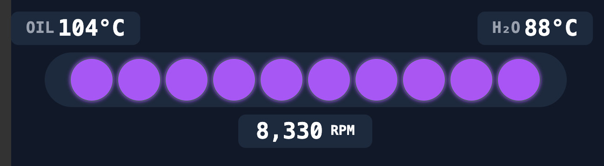

### Shift Light

A standalone shift indicator for drivers who do not need the full Tachometer widget.

**Features:**

- Automatic shift cues or custom shift points for each car and gear
- Glow, border, or pulse indicators with configurable colour
- Optional RPM readout

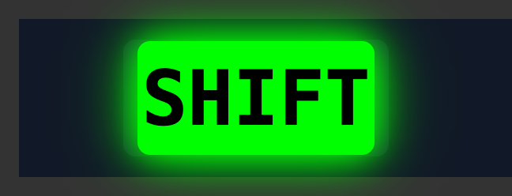

### Car Systems

Displays your car's in-car adjustments in one compact widget.

**Features:**

- Live brake bias, ABS, traction control, and other adjustments supported by your car
- Car-specific control labels, including brake migration, brake valves, and engine maps
- Configurable columns, with independent options to hide unsupported or switched-off systems

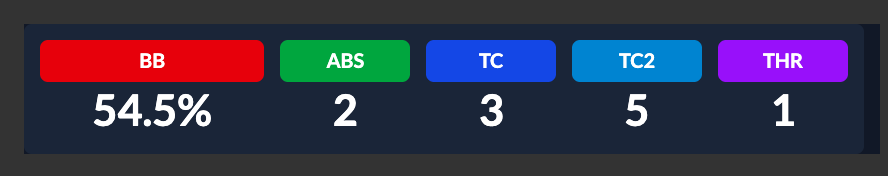

### Standings

Displays standings information for the current session.

**Features:**

- Driver information: position, car number, country flags, driver name, team name, pit status
  - Country flags: Support for 250+ countries, can be enabled/disabled, shows iRacing flag for unaffiliated drivers
  - Driver name format: Multiple display formats (e.g., "J. Smith", "John S.", "John Smith", etc.)
  - Configurable name subtext: Show the team below the driver name or the driver below the team name; team names appear beneath driver names by default in team sessions
  - Pit status indicators: DNF (red), TOW (orange, animated), OUT (green), PIT (yellow, animated), last pit lap number, repair/meatball flag (orange dot), penalty/black flag (orange), slowdown (orange, animated)
  - Optional pit time display
  - Pit lap display mode: Show pit lap number or laps since last pit
  - Compact Mode: Three levels (Off, Compact, Ultra) for maximum information density
  - Incidents & Off-tracks: Driver rows highlight in yellow when they go off-track
  - Spectator Support: Automatically follows the driver you are watching in iRacing
- Driver Tags: Assign color-coded visual indicators to specific drivers
  - Preset groups: Dangerous, Friend, Twitch, YouTube — each with a unique icon and color
  - Custom groups with custom names, colors, and icons (600+ icons or uploaded images)
  - Display styles: icon badges or compact colored pills
  - Driver labels: custom display names that alternate with the real driver name on a configurable timer
  - Toggle the driver tag column on or off per widget
- Car details: manufacturer (with option to hide if single-make series), tire compound
- Driver badges with multiple format options (license/rating combinations)
  - Full iRating: Option to display the full iRating value instead of just the badge
- Styling customizations: toggle minimal license badges, minimal status badges, position background color, and car number background/border independently
- Timing information: gap, interval, best lap time, last lap time (multiple time format options)
  - Configurable decimal precision (1, 2, or 3) for gap and interval
  - Gap and interval display in practice and qualifying sessions
- Optional column headers
- Class headers:
  - Estimated race lap counts, or scheduled totals in fixed-lap races
  - Compact Strength of Field values and optional manufacturer counts
- Class ordering: Use iRacing's class order or sort by each class leader's overall position
- Optional Push-to-Pass column, showing a driver's active state and remaining time in supported series
- Configurable radio icon duration, so recent transmissions remain visible without flickering
- iRating change display, with optional hypothetical estimates during online practice
- Lap time deltas (configurable number of laps: 1-5)
- Title bar with session progress bar
- Header and footer bars with customizable items and display order:
  - Session name, session time (remaining/elapsed), session clock time, incident count
  - Enhanced incident display showing your count against the initial and subsequent incident limits (e.g. "3 / 8 / 12 x")
  - Brake bias, local time, track wetness, precipitation, humidity, wind speed/direction
  - Air and track temperature (Metric/Imperial units)
  - Track name
  - Fuel level, last and best lap times, top speed, manufacturer position, and class rank
  - Session time: configurable mode (Remaining/Elapsed), format, and label style
  - Accurate race clock for fixed-lap races (calculated from P1 average lap time)
  - Remaining-lap estimates in lone qualifying
- Driver standings configuration:
  - Drivers to show around player
  - Drivers to show in other classes
  - Minimum drivers in player's class
  - Top drivers to always show
  - Configurable divider line between pinned and remaining drivers
- Optional position change column (arrows vs qualifying grid baseline)
- All drivers shown immediately at practice/pre-qualifying start (sorted by car number)
- Toggle to strip car numbers from driver names
- Customizable display order for all columns
- Widget scaling from 50% to 200%
- Adjustable background opacity
- Option to show only when on track
- Option to use live position standings (updates continuously vs only at start/finish line)
- Session visibility settings (Race, Lone Qualify, Open Qualify, Practice, Offline Testing)

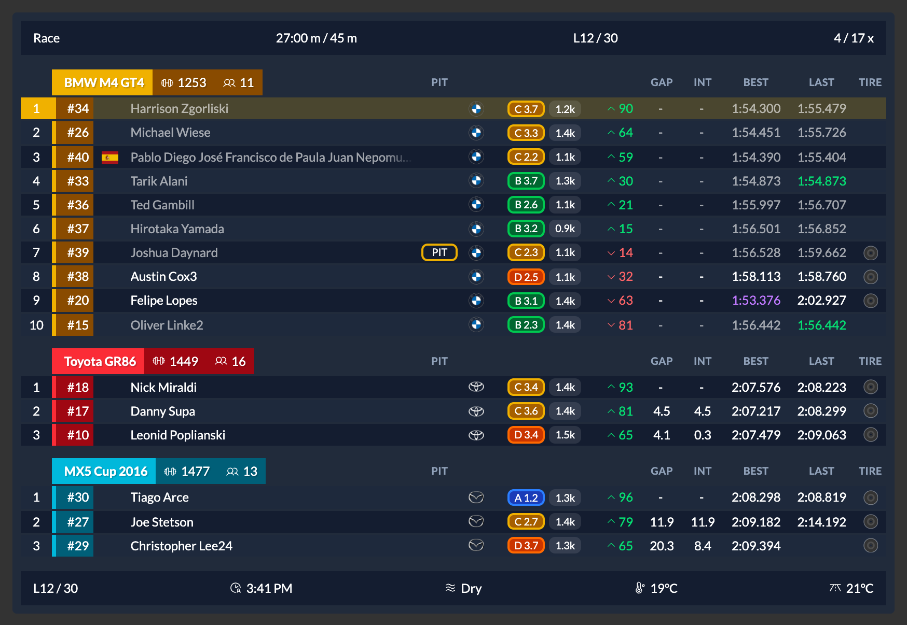

### Relative

Displays drive relative delta information for the current session.

**Features:**

- Driver information: position, car number, country flags, driver name, team name, pit status
  - Country flags: Support for 250+ countries, can be enabled/disabled, shows iRacing flag for unaffiliated drivers
  - Driver name format: Multiple display formats (e.g., "J. Smith", "John S.", "John Smith", etc.)
  - Pit status indicators: DNF (red), TOW (orange, animated), OUT (green), PIT (yellow, animated), last pit lap number, repair/meatball flag (orange dot), penalty/black flag (orange), slowdown (orange, animated)
  - Optional pit time display
  - Pit lap display mode: Show pit lap number or laps since last pit
  - Compact Mode: Three levels (Off, Compact, Ultra) for maximum information density
  - Incidents & Off-tracks: Driver rows highlight in yellow when they go off-track
  - Spectator Support: Automatically follows the driver you are watching in iRacing
- Driver Tags: Assign color-coded visual indicators to specific drivers
  - Preset groups: Dangerous, Friend, Twitch, YouTube — each with a unique icon and color
  - Custom groups with custom names, colors, and icons (600+ icons or uploaded images)
  - Display styles: icon badges or compact colored pills
  - Driver labels: custom display names that alternate with the real driver name on a configurable timer
  - Toggle the driver tag column on or off per widget
- Car details: manufacturer (with option to hide if single-make series), tire compound
- Driver badges with multiple format options (license/rating combinations)
- Styling customizations: toggle minimal license badges, minimal status badges, position background color, and car number background/border independently
- Relative delta timing display with configurable precision
- Timing information: best lap time, last lap time (multiple time format options: full, mixed, minutes, seconds-full, seconds-mixed, seconds)
- Optional Push-to-Pass column, showing a driver's active state and remaining time in supported series
- Configurable radio icon duration, so recent transmissions remain visible without flickering
- Lap time delta column (configurable number of laps: 1-5)
- Optional flag contour: draws a colored border around the widget when a session flag is active, with configurable border width
- iRating change display (optional)
- Enhanced gap calculation with advanced options:
  - Interpolation methods (linear, cubic spline)
  - Configurable max lap history (3, 5, 7, or 10 laps)
  - Uses position/time records for accurate multi-class gaps
- Title bar with session progress bar
- Header and footer bars with customizable items and display order:
  - Session name, session time (remaining/elapsed), session clock time, incident count
  - Brake bias, local time, track wetness, precipitation, humidity, wind speed/direction
  - Air and track temperature (Metric/Imperial units)
  - Track name
  - Fuel level, last and best lap times, top speed, manufacturer position, and class rank
  - Session time: configurable mode (Remaining/Elapsed), format, and label style
- Configurable number of drivers to show around player (1-10)
- Optional position change column showing positions gained or lost within each class from the qualifying grid during races
- Optional pit-stall filtering to hide stopped drivers while keeping pit-road traffic and the focused car visible
- Toggle to strip car numbers from driver names
- Customizable display order for all columns
- Adjustable background opacity
- Option to show only when on track
- Option to use live position (updates continuously vs only at start/finish line)
- Session visibility settings (Race, Lone Qualify, Open Qualify, Practice, Offline Testing)

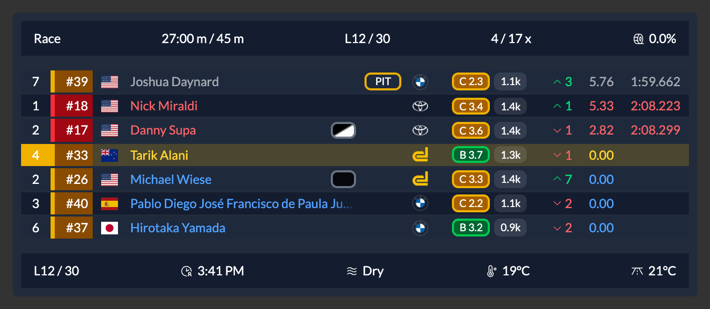

### Track Map

Displays a track map with the current position of the cars on track and the track layout with the turn numbers / names.

**Features:**

- Real-time car positions on track (live telemetry)
- Track layout visualization
- Optional turn numbers and names display
  - Toggleable high contrast backgrounds for turn name labels
  - Adjustable turn name font sizes
- Pit lane highlighting with "P" indicators for cars in the pits
- Show/hide car numbers on driver circles
- Configurable driver and player circle sizes (10-100px)
- Configurable track line width (1-100px) and outline width (1-150px)
- Option to invert track colors (black track with white outline)
- Option to use highlight color for player circle
- Custom player car icon: upload an image (PNG, JPG, GIF, WebP, SVG) to replace your player circle
- Option to use an inverted color for the leader to make them stand out
- Multi-class support
- Session visibility settings (Race, Lone Qualify, Open Qualify, Practice, Offline Testing)
- Race positions: Driver circles can display their current race position
- Off-track highlighting: Car markers highlight when a driver goes off the track (yellow outline)
- Styling customizations: toggle minimal track outline and minimal car marker shadows

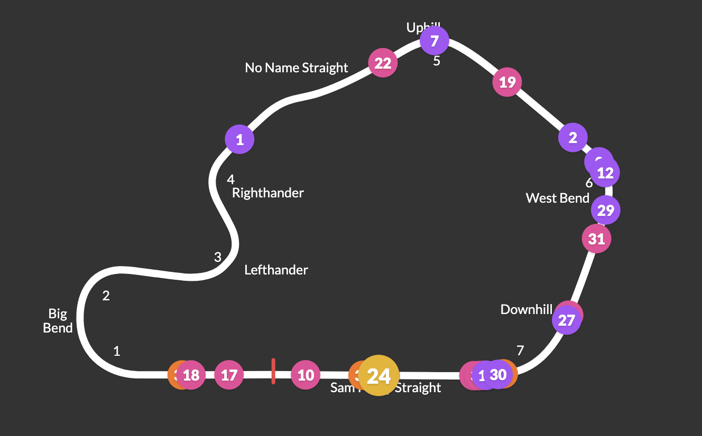

### Flat Track Map

Displays a simplified horizontal track map showing driver positions along a flat line representation of the track. Similar to Track Map but uses a linear horizontal layout.

**Features:**

- Real-time car positions on horizontal track line
- Start/finish line with checkered flag
- Show/hide car numbers on driver circles
- Configurable driver and player circle sizes (10-100px)
- Configurable track line width (5-40px) and outline width (10-80px)
- Option to invert track colors (black track with white outline)
- Option to use highlight color for player circle
- Auto-scales to container width
- Multi-class support

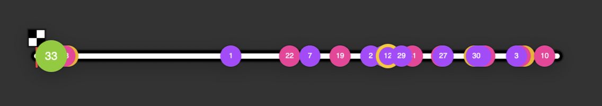

### Weather

Displays the weather information for the current session.

**Features:**

- Current weather conditions: track state, track and air temperature, wind speed and direction, humidity, precipitation, track wetness
- Vertical, horizontal compact, and horizontal full layouts
- Optional humidity display
- Customizable display order for all weather elements
- Temperature units: Auto (based on iRacing settings), Metric (°C), or Imperial (°F)
- Adjustable background opacity
- Option to show only when on track
- Session visibility settings (Race, Lone Qualify, Open Qualify, Practice, Offline Testing)

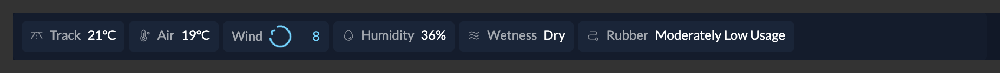

### Wind

Displays wind direction and speed as a standalone overlay.

**Features:**

- Wind compass with live direction and intensity
- Speed units: Auto, km/h, or mph
- Adjustable background opacity and on-track/session visibility controls

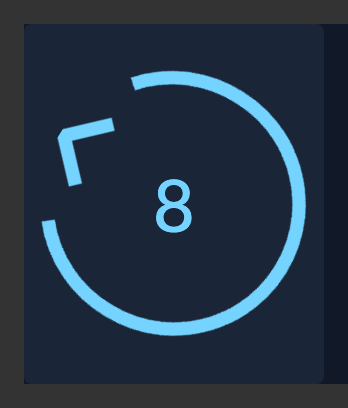

### Faster Cars From Behind

Displays information about faster cars approaching from behind, including driver name, distance, and a visual indicator that pulses when cars are close.

**Features:**

- Driver name and distance display
- Visual pulsing indicator when cars are close
- Configurable distance threshold for alerts
- Real-time detection of faster approaching cars
- Pit status filtering: Option to exclude cars in the pits
- Automatically hidden when on pit road
- Multiple driver display settings for more control over what's shown

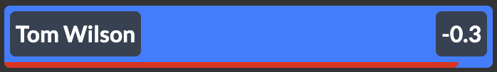

### Fuel Calculator

Displays comprehensive fuel management information including current fuel level, fuel consumption per lap (min, max, averages), pit window timing, fuel required to finish, and consumption history graphs. Features a complete redesign with visual layout editing and real-time consumption calculations.

**Features:**

- Fuel units: Liters (L) or Gallons (gal)
- Compact mode: Three levels (Off, Compact, Ultra) for information density
- Visual layout editing: Drag and drop widgets to customize your fuel display
- Layout options: Vertical or horizontal
- Real-time consumption calculations with pit strategy recommendations
- Multiple display widgets for flexible information presentation
- Consumption statistics:
  - Minimum consumption
  - Last lap consumption
  - 3-lap average
  - 10-lap average
  - Maximum consumption
  - Fuel required calculations
- Pit window timing information
- Endurance strategy display (total pit stops and stint info for long races)
- Consumption history graphs:
  - Line chart or histogram
  - Optional lap table showing fuel used per completed lap
  - Configurable history length
- Configurable safety margin (0-20%) for fuel calculations
- Adjustable background opacity
- Earliest pit lap: Shows the earliest possible lap you can pit and still finish the race
- Fuel-to-add mode: Toggle between showing total fuel needed or just what's needed at the next stop
- Target consumption: Shows what fuel saving is required to reach specific lap targets (±1 from current estimate)

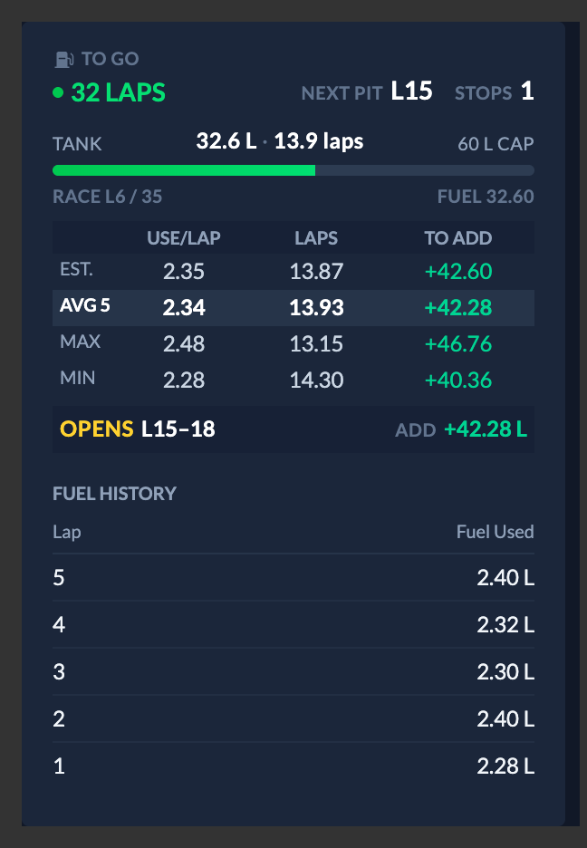

### Blind Spot Monitor

Displays visual indicators on the left and right sides of the screen when cars are detected in your blind spots. The indicator position dynamically adjusts based on the distance to the detected car.

**Features:**

- Left and right side detection with three-wide scenario support
- Visual amber indicator bars that move vertically based on car distance
- Detection of single car or multiple cars on each side
- Configurable border size (0-20px) and indicator color
- Configurable detection distances:
  - Distance ahead (3-6 meters)
  - Distance behind (3-6 meters)
- Adjustable indicator width (5-100px)
- Adjustable background opacity
- Only displays when on track
- Real-time position tracking based on lap distance
- Standard bar or compact Simple mode, with configurable indicator size, position, car count, and colours

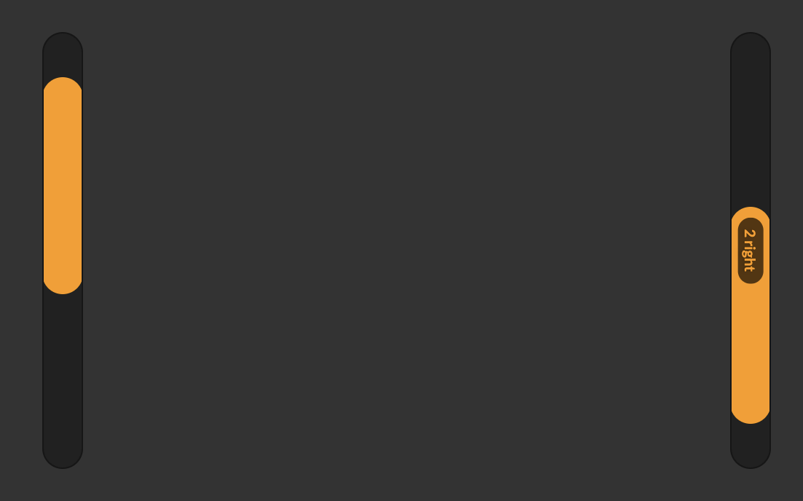

### Radar

Shows nearby rivals ahead, behind, and alongside your car. iRacing positions are estimated from track position and spotter calls.

**Features:**

- Nearby traffic display with bumper-to-bumper gaps and grid or pace-line formations
- Configurable warnings for close rivals, fast-closing cars, and hazards ahead, including slow, crashed, and rejoining cars
- Warnings stay quiet during formation and full-course cautions
- Appearance presets, road or oval profiles, colours, distance rings, car numbers, and warning labels
- Live settings preview and configurable session visibility, including warmup

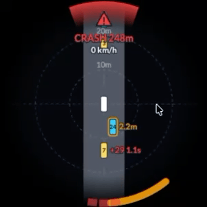

### Battle

Displays a compact three-row view of the cars immediately ahead of and behind you in class position, alongside your own row.

**Features:**

- Live gap, previous-lap gap, and gap-change display
- Optional position, car number, driver name, stint length, last lap time, and speed columns
- Reorderable columns and configurable gap precision, lap-time format, and speed units
- Last-lap highlights for personal-best and session-fastest laps
- Adjustable background opacity and on-track/session visibility controls

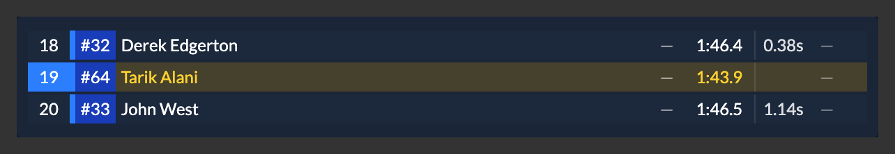

### Slow Car Ahead Warning

Displays a warning indicator when a slower car is detected ahead on the track. The distance in meters to the car is displayed, as well as bars that grow as the car gets closer. The color of the bars change based on the track position and speed of the slow car:

- Green: Car is off-track
- Amber: Car is on-track and moving (depends on configured threshold)
- Red: Car is on-track and stopped, or moving very slowly (depends on configured threshold)

**Features:**

- Adjustable distance threshold
- Adjustable slow speed threshold
- Adjustable stopped speed threshold
- Adjustable bar thickness
- Automatically hidden when on pit road

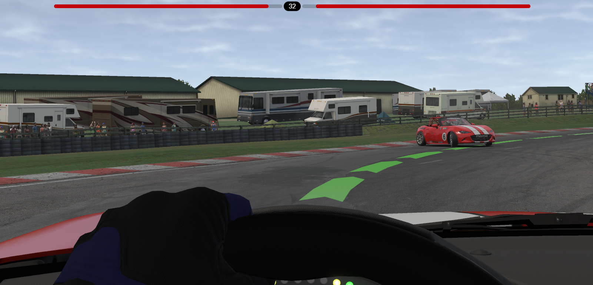

### Garage Cover

Displays a custom image overlay when you are in the garage. Perfect for streaming to show a branded or custom image while in the garage instead of the default iRacing garage view.

**Features:**

- Custom image upload (drag and drop or file selection)
- Only displays when in garage
- Browser source compatible for OBS and other streaming software
- Accessible via browser at `http://localhost:3000/dashboard` (displays as part of your dashboard)
- Image preview in settings

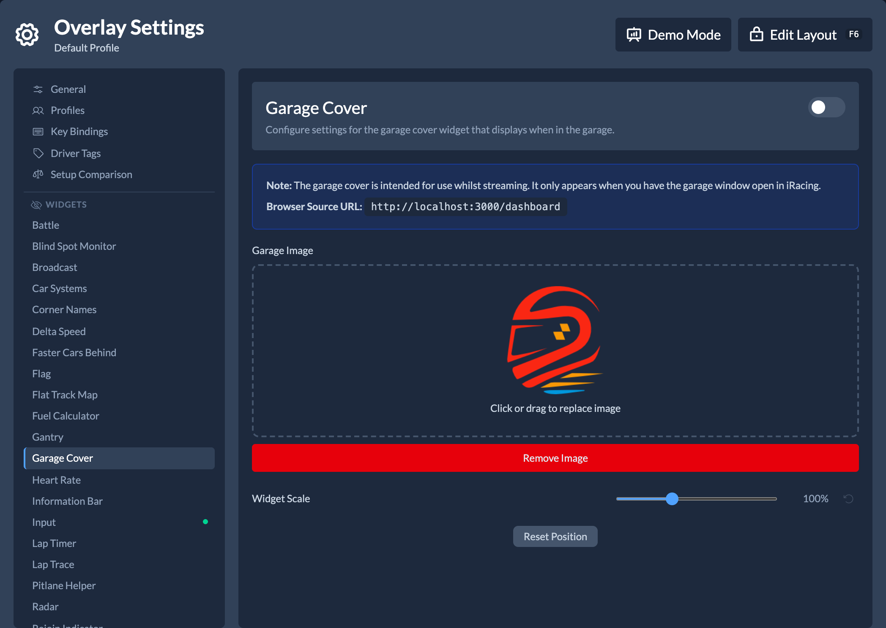

### Rejoin Indicator

Displays a safety indicator showing the gap to the car behind and whether it's safe to rejoin the track after leaving the pits or garage. Provides clear visual feedback with color-coded status (Clear/Caution/Do Not Rejoin).

**Features:**

- Real-time gap calculation to the nearest on-track car behind
- Color-coded status indicators:
  - Green (Clear): Safe to rejoin (gap above care threshold)
  - Amber (Caution): Exercise caution when rejoining (gap between care and stop thresholds)
  - Red (Do Not Rejoin): Not safe to rejoin (gap below stop threshold)
- Configurable speed threshold (default: 30 km/h) - only shows when at or below this speed
- Configurable gap thresholds:
  - Care gap: Distance where caution is needed
  - Stop gap: Distance where rejoining is unsafe
- Automatically hides when:
  - Player is in garage, pit stall, or on pit road
  - No valid on-track car is detected behind
  - During standing start (pre-race session states)
- Only displays when driving and on track

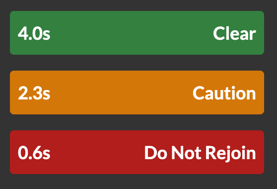

### Pitlane Helper

Helps you manage your pit stops with clear visual guidance. It assists with speed limits, finding your pit box, and monitoring pitlane traffic.

**Features:**

- Speed Limit Assistant: Vertical colour-coded indicator (Green/Amber/Red) showing proximity to the pit speed limit, toggleable speed bar with decimal precision and selectable speed unit (Auto/MPH/KM/H).
- Pitbox Countdown: A distance tracker and progress bar show exactly how far you are from your pit stall.
- Countdown Bars: Colour-coded progress bars for pit entry, pitbox, and pit exit distances (Green -> Yellow -> Blue).
  - Configurable vertical/horizontal orientation with side-by-side layout option
  - Three semantic rows (32x80px) for compact display
- Pit Exit Inputs: Throttle/clutch display to optimize pit exits with phase-based visibility options.
- Traffic Monitor: See how many cars are currently ahead or behind you in the pitlane.
- Fully resizable with theme-matching background
- Early Warning: Alerts you if your pitbox is located near the pit entry.
- Pit limiter alerts: Flashing warnings if you enter the pits without your limiter active (auto-disabled for series with automatic limiters).
- Calibration controls in Settings: View and reset learned pit-lane positions for the current track, or open and reload the calibration file after manual edits.

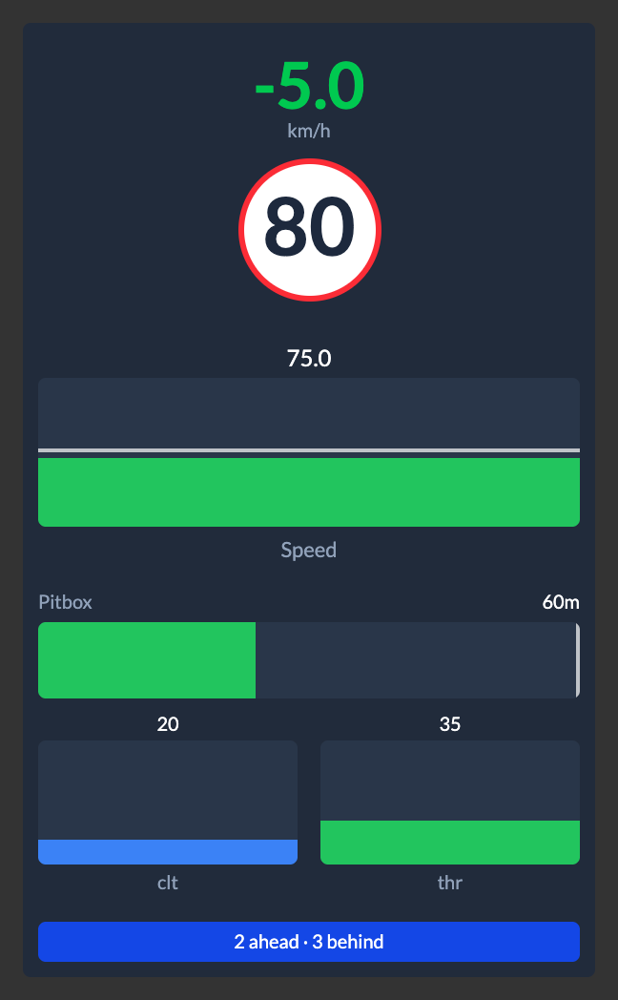

### Lap Timer

**Features:**

- Current lap: Show current lap time, highlights green for personal best and purple for session best.
- Predicted lap: Shows an estimate of the lap time based on the current delta.
- Best and last lap: Display the best and last lap times.
- Personal best lap: Optionally show the best lap ever recorded by irDashies for the current car and track combo, persisted across sessions.
- Lap history: Show a history of your most recent lap times along with optional deltas.
- Optionally hide pit laps from the lap history list and graph.
- Fully configurable: Decide which laps your interested in and toggle them on and off individually.
- Fully customisable: Resize, scale and align to position the widget to your taste.

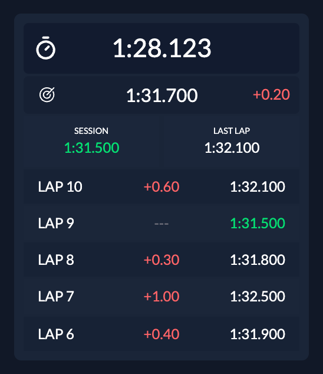

### Sector Delta

Displays per-sector timing deltas for the current lap, colour-coded by performance against a ghost lap or your session best. Sectors are shown as a strip that can scroll continuously with the current sector pinned to the centre.

**Features:**

- Per-sector deltas coloured green/yellow/red based on performance vs reference
- Comparison source: ghost lap when available, or session best only
- Continuous scrolling strip with the current sector position-pinned to the centre
- Option to limit the number of visible sectors (sliding carousel)
- Track incident sectors: sectors where you picked up incidents are flagged with a warning icon
- Configurable colour thresholds (green and yellow limits as a percentage of session best)
- Time format with configurable decimal precision
- Adjustable background opacity

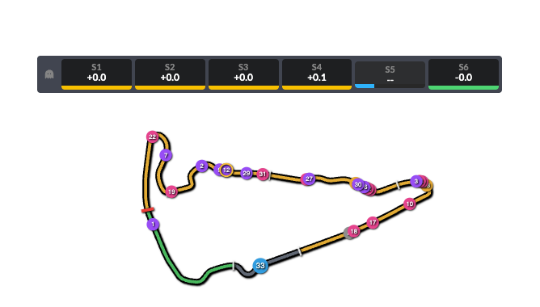

### Delta Speed

Compares your current speed with your session-best clean lap at the same point on track.

**Features:**

- Colour indicator fades toward green when faster and red when slower
- Optional numeric speed difference, with Auto, km/h, or mph units
- Shows "No clean lap" until a usable reference is available

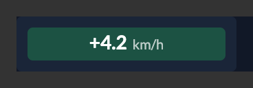

### Flag Widget

Displays racing flags in an LED-matrix style, automatically showing the most relevant flag when multiple are active. Perfect for keeping track of track conditions and race control messages.

**Features:**

- LED-matrix style flag display
- Automatic flag priority: Shows the most important flag when multiple are active
- Support for all iRacing racing flags (green, yellow, white, checkered, blue, black, etc.)
- Option to display two identical flags within a single widget
- Matrix mode: choose the LED resolution (8x8, 16x16, or uniform 1x1) for a more detailed or compact look
- Optional flag label and "no flag" state display
- Optional glow effect and configurable flag animation (toggle plus blink period)
- Customizable size and positioning
- Adjustable background opacity
- Session visibility settings (Race, Lone Qualify, Open Qualify, Practice, Offline Testing)

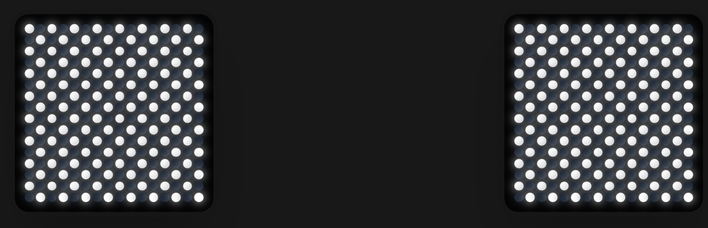

### Setup Comparison Tool

Side-by-side setup analysis to compare car setup changes between sessions.

**Features:**

- Side-by-side setup diff with changed values highlighted in red
- Snapshot timestamps for each saved setup
- Move setups left/right to reorder comparisons

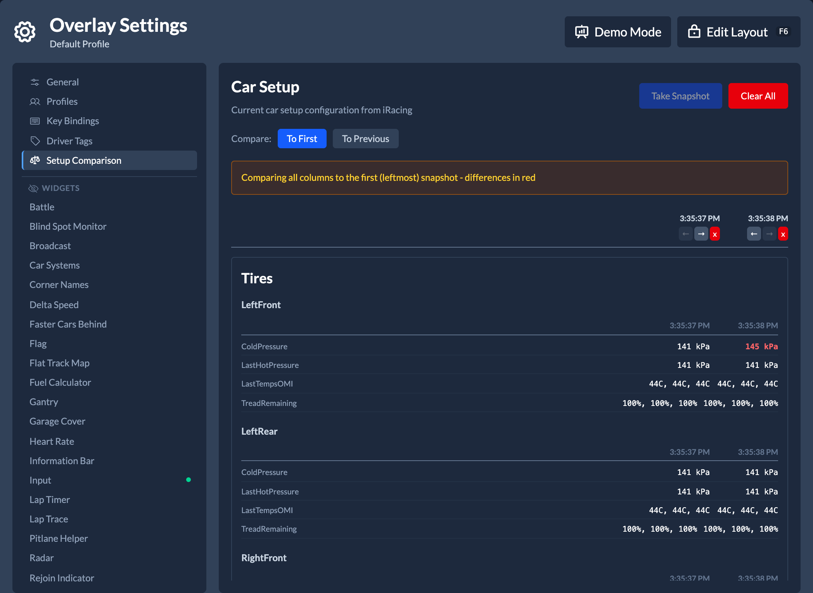

### Twitch Chat Overlay

Displays live Twitch chat directly in your overlay, useful for streamers who want chat visible while racing.

**Features:**

- Live chat display with configurable channel name (no OAuth required)
- Emoji support
- Colored nicknames using each chatter's Twitch username color
- Optional auto-disappearing messages with a configurable interval (10-90s)
- Configurable font size and background opacity
- Visible even when iRacing is not running

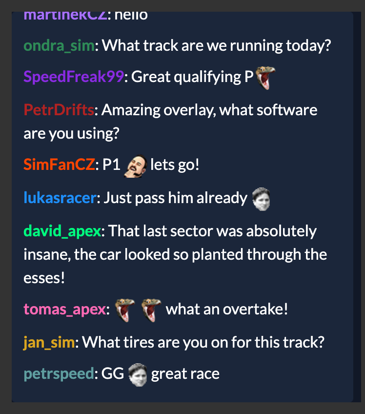

### Heart Rate

Displays your live heart rate from [HypeRate](https://www.hyperate.io/) by embedding its overlay — no API key or account required, just your session id.

**Features:**

- No key/account needed — paste the session id from your HypeRate share link (`app.hyperate.io/`**`KiY`**)
- Optional widget/theme: paste any HypeRate widget link or name (e.g. `Bouncing_Heart_Widget`, or an `app.hyperate.io/animation/<n>/...` route); your session id is filled in automatically and any baked-in id is ignored
- Transparent background and no scrollbar (the embedded page is restyled like an OBS browser source)
- Auto-fits the graphic to the widget and scales it on resize (no truncation)
- Visible even when iRacing is not running

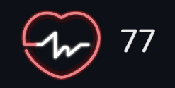

### Information Bar

A standalone widget that displays session and timing information independently from the Standings and Relative widgets.

**Features:**

- Displays flag status, lap counter, session time, and other session info
- Optional fuel level, last and best lap times, top speed, manufacturer position, and class rank
- Weather items including humidity, precipitation, wind, and air/track temperature
- Fully configurable: reorder items and toggle each one on or off
- Adjustable background opacity
- Session visibility settings (Race, Lone Qualify, Open Qualify, Practice, Offline Testing)

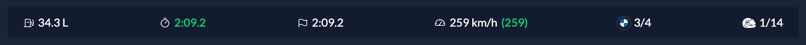

### Telemetry Inspector

A powerful tool for viewing live data coming from the active simulator, with units shown for known values. While mostly used for debugging, it's great for seeing exactly what data the app is receiving in real-time.

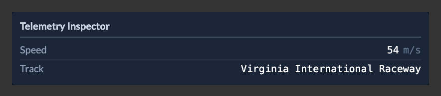

### Corner Name Overlay

Displays the current track section (corner or named straight) along with corner number and progress through the section. Track section data is sourced from [lovely-track-data](https://github.com/Lovely-Sim-Racing/lovely-track-data).

**Features:**

- Section name display (e.g. "Eau Rouge", "Kemmel Straight", "La Source")
- Corner number badge (e.g. T1, T12) when the section is a numbered turn
- Progress bar showing position within the current section
- Optional overall lap-distance percentage
- Configurable font size and background opacity
- Session visibility settings (Race, Lone Qualify, Open Qualify, Practice, Offline Testing)

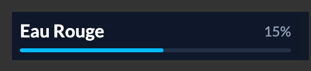

### The Gantry

A race control window with live standings, an automatic incident feed, and a per-lap graph. Unlike the other widgets it opens in its own resizable window instead of sitting on top of the sim, so it suits a second monitor, a spotter, or a race director. Enable it in Settings, then use **Show Window** to bring it back if you close it.

**Features:**

- Standings and incidents shown side by side with a draggable divider, plus a separate Lap Graph tab
- Optional always-on-top mode, controlled from the tab bar or settings for windowed or borderless simulators
- Dock Fuel Calculator, Track Map, or Flat Track Map panels beneath the incident feed, side by side or in tabs, with optional Gantry-only fuel layouts
- Review recorded incidents and lap history while watching an iRacing replay; history follows the selected replay session and requires recordings made by irDashies on this PC
- Final standings and lap graphs remain available after iRacing closes, including when switching tabs, until the next session loads or irDashies closes
- Standings list
  - Grouped by car class: position, car number, driver name, tyre compound, iRating, pit/DNF status
  - Gap to the class leader, interval to the car ahead, best lap and last lap
  - Lap deltas for the last three laps, each compared against your own lap of the same age (green means they were slower than you, red means faster)
  - Configurable driver name format
  - Click a row to point the sim camera at that car (works in a replay or while spectating)
- Incident feed
  - Detects crashes, off-tracks, slowdowns, pit entries, and black flags as they happen
  - Filter chips per incident type, plus a dropdown to narrow the feed to a single driver
  - Group incidents by practice, qualifying, warmup, and race, with filters for the current session or a chosen session
  - Replay jump buttons (-5s, -10s, -30s) move the sim's replay to just before the incident and point the camera at the car
  - Choose the camera used for incident replays, defaulting to Far Chase
  - Incidents are saved to disk: keep every session, or only the last 5, 10, or 20
  - Tunable detection thresholds: slow speed and duration, crash impact severity and minimum speed, off-track duration, pit entry duration, and a per-type cooldown
  - Threshold speeds shown in mph, km/h, or auto (always stored in km/h, so switching units never changes detection)
- Lap Graph
  - Three y axes: Race Trace (time gained or lost against the class leader's reference pace), Position (class position at the end of each lap), and Gap (seconds behind the class leader)
  - Consistent driver colours and dash patterns, with matching swatches in the driver list
  - Class selector for multi-class sessions
  - Pin drivers from the side list, or let auto-pin follow the player, the class leader, and the cars around the player
  - Hover the chart for a crosshair readout of the nearby lines; hover a name to lift that driver's line above the field
  - Pan and zoom the lap window by dragging or scrolling, with an overview strip below the chart, and it follows the latest lap
  - Configurable default axis, laps shown, and auto-pin

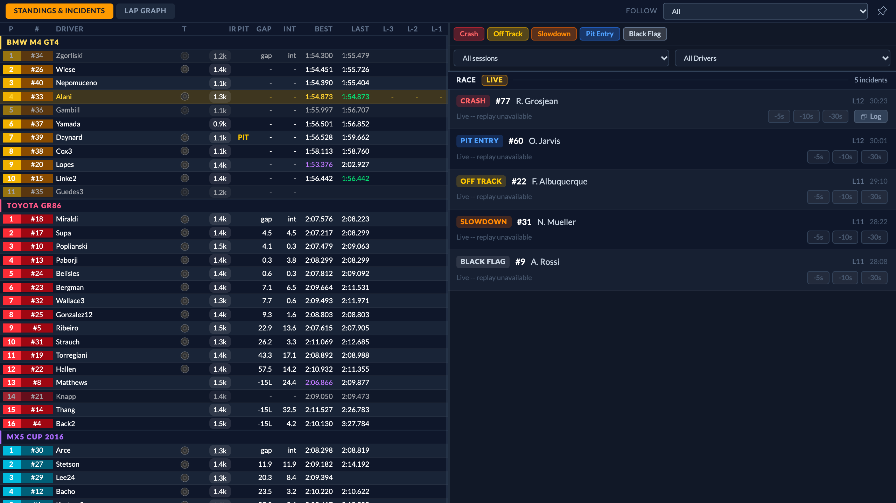

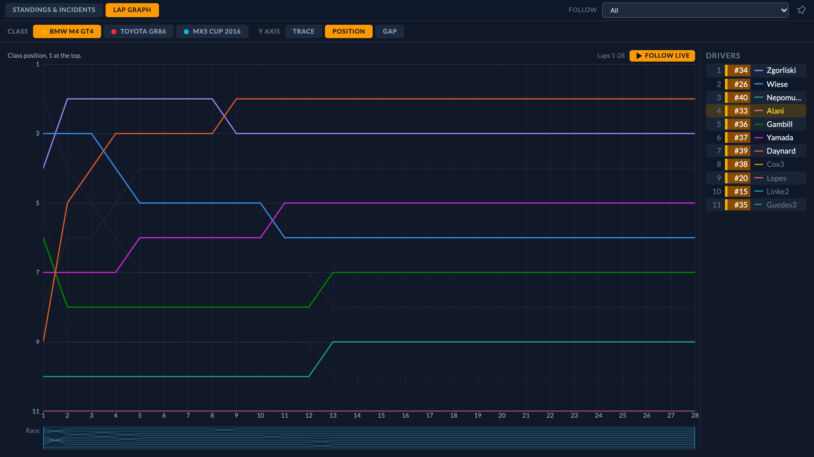

### Broadcast overlays

TV-style overlays for iRacing streams, configured together in **Settings > Broadcast**. Each is an independent widget with its own position and browser-source URL.

**Features:**

- **Tower:** Multi-class standings with rotating or fixed pages for names, gaps, positions gained, pit stops, and tyres; optional focused-driver card and pre-race/post-race screens
- **Ticker:** A scrolling standings strip for the bottom of your broadcast
- **Events:** Timed alerts for incidents, flags, fastest laps, pit stops, and race milestones, with selectable event types
- **Weather:** A weather panel shown at configurable intervals
- **Podium:** Class podiums after the checkered flag, with steps or trophy styles
- IMSA, WEC, and F1 themes, a custom logo and title, and configurable backgrounds

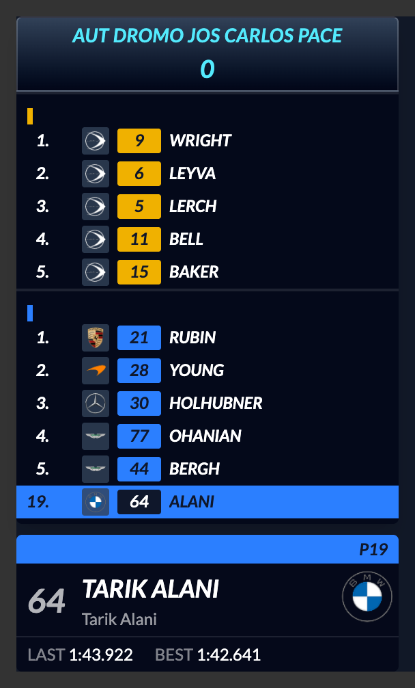

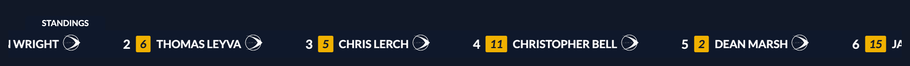

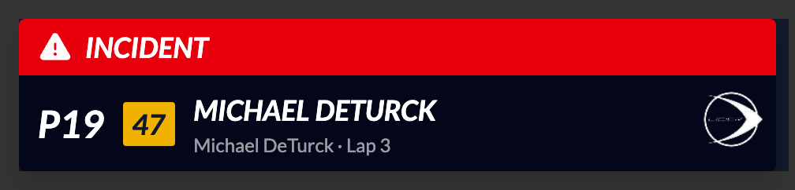

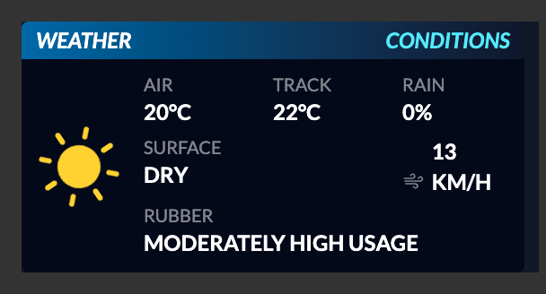

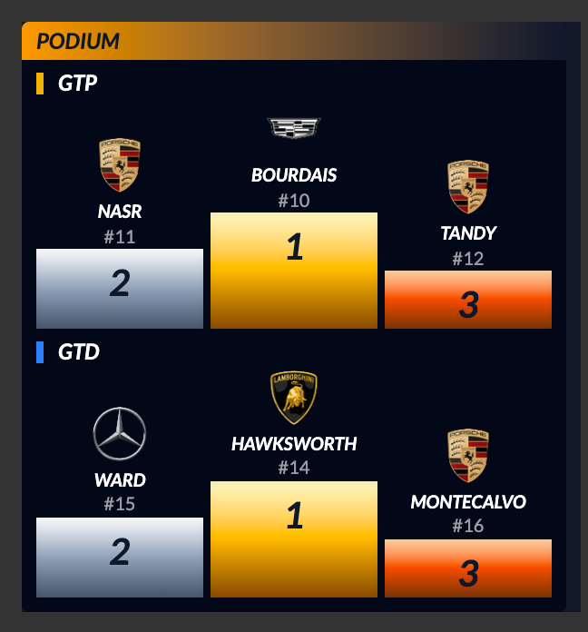

### Other Features

**Features:**

- Profile Management
  - Save and switch between different dashboard configurations
  - Multiple profiles for different racing scenarios or streaming setups
  - Assign profiles to practice, qualifying, races, testing, time trials, and warmup for automatic layout switching
  - Optional spotting profile activates after 20 seconds out of the car and switches back immediately when you resume driving
  - Clone existing profiles with one click to create variations without starting from scratch
  - Bind shortcuts to cycle to the previous or next profile, with an on-screen profile-name banner
  - Each profile can be accessed as its own browser source URL for OBS streaming
  - Dashboard import/export to share layouts between users or back up your setup
- Streamer & OBS Ready
  - Built-in Web Server: All overlays can be used as a browser source in OBS. `http://localhost:3000/dashboard` follows the active profile; `http://localhost:3000/dashboard?profile=<profileId>` selects a specific profile. Copy the actual URLs from Settings > Profiles if the server uses another port.
  - Separate browser layouts: Each profile stores its browser widget positions independently of the desktop layout. Use **Settings > Profiles > Actions > Edit Browser Layout** to arrange widgets for OBS. Set the browser source's width and height to match your intended canvas.
  - Single Widget URLs: `http://localhost:3000/widget/<widgetId>` shows one widget filling the page, including widgets hidden from the desktop layout, for hosts that take one page per source such as OpenKneeboard in VR. `http://localhost:3000` lists the URL for every widget in the active dashboard; older component links redirect to the widget pages.
  - Optional Web Server: Disable the built-in server when browser sources are not needed; restart the app to free its port.
  - Network Access: Enable network access in settings to allow other devices on your local network to access the dashboard (useful for dual-PC streaming setups).
  - Garage Cover: Automatically hide your screen with a custom image when you enter the garage to keep your car setup private.
  - Transparent backgrounds: All overlays are designed to look great on top of your game or stream.
  - Reduced GPU usage: Overlay windows are sized to fit only the widgets on each display, rather than covering the full screen.
- Customization & Themes
  - Per-widget scaling: Scale any widget's text and content from 50% to 200% independently in its settings, then resize its container to fit your layout.
  - Color themes: Choose from built-in themes or create your own custom look.
  - Highlight color: Pick a custom color that is used across all widgets to match your branding or preference.
  - Font sizes: Multiple font size options (including 2x Small, 3x Small, and Tiny for large or ultra-wide monitors) to ensure readability on any screen.
  - Font weight: Choose between Normal, Bold, or Extra Bold text for improved readability.
- Ease of Use
  - Configurable key bindings: Rebind shortcuts for global overlay visibility, edit layout, telemetry, layout-profile cycling, and individual widget visibility. Supports keyboard chords, controller buttons, and controller-button combos.
  - Per-widget visibility shortcuts: Show or hide individual widgets without affecting the rest of the dashboard.
  - Global toggle (Alt+H by default): Quickly hide or show all your overlays with a single keyboard shortcut.
  - Reset widget position: Reset any widget's position to the top-left corner if it gets lost off-screen.
  - Close to tray: Closing the window minimizes to the system tray instead of quitting (configurable).
  - Always on top: Keep your overlays visible even when clicking on other windows.
  - System autostart: Optionally have the app start automatically when your computer boots up.
  - Start minimized: Launch the settings window in minimized state for a cleaner desktop
  - Auto port fallback: If port 3000 is in use, the app automatically tries the next available port and updates all URLs in settings.
  - Configurable Chromium flags: Advanced Settings exposes recommended graphics fixes (disable native window occlusion, ANGLE backend selection, disable Direct Composition) plus custom enable/disable feature lists and freeform switches for troubleshooting rendering issues (e.g. black flickering on some GPUs).
  - Log file access: Open the log folder or export the log file directly from Advanced Settings.
  - Automatic updates: The app keeps itself up to date with the latest features and bug fixes.

## Prerequisites (for development)

- Node.js (v24 or higher, matching `package.json`)
- npm (comes with Node.js)
- Windows build tools if you are on Windows
  - Modern Node.js installations include the necessary build tools. If you encounter issues building native modules, ensure you selected the option to install build tools during Node.js installation, or reinstall Node.js with build tools enabled.
- Windows and an installed simulator for live telemetry (iRacing, or Le Mans Ultimate for the supported beta widgets)

> Note: Developing on MacOS is fully supported and does not require iRacing or any additional tools to be installed as it uses a mocked SDK.

## Installation (for development)

To install irDashies for development, follow these steps:

1. Clone the repository
2. Navigate to the project directory
3. Install the required dependencies:

```bash
npm ci
```

4. Run the application:

```bash
npm start
```

5. Optionally, you can run the storybook to view the components in isolation:

```bash
npm run storybook
```

## Usage (for development)

To start using IRDashies, run the following command:

```bash
npm start
```

This will start the application.

Look for the application in your app tray.

### Simulator overrides

For normal use, choose the simulator in **Settings > General > Simulator**. See [Supported simulators](#supported-simulators) for LMU setup and beta limitations.

To override the saved simulator setting, use `irdashies.exe --sim=lmu` or
`irdashies.exe --sim=iracing`. For development, set `IRDASHIES_SIM` instead:

```powershell
$env:IRDASHIES_SIM = 'lmu'
npm start
```

Without an override, irDashies uses the saved simulator preference. In Auto mode,
it detects the running simulator and follows changes without restarting, giving
iRacing priority if both simulators are active when detection runs.

> You will need to have Node.js installed on your machine to run the application. You can download it from [here](https://nodejs.org/).

> On macOS you will see mocked data from a sample session. To connect to iRacing, you will need to run the application on Windows.

While developing, it's recommended you run Storybook as it gives you a quick way to iterate your changes:

```bash
npm run storybook
```

## Folder Structure

The project is structured as follows:

```
irdashies/
  ├── src/
  │   ├── app/
  │   ├── frontend/
  │   ├── types/
```

- `src/app/` contains the main Electron application code.
- `src/app/irsdk/` contains the iRacing SDK code including the native C++ bindings.
- `src/app/processors/` computes derived telemetry and publishes typed channel snapshots.
- `src/frontend/` contains the React components for the overlays.
- `src/frontend/domain/` contains shared selectors and widget-independent UI logic.
- `src/types/` contains TypeScript type definitions shared between the frontend and backend (e.g. telemetry types).
- `src/types/widgets/` contains widget manifests, default layouts, and settings metadata; widgets register their React components in a co-located `widget.ts`.

> Note: Frontend components should NOT import anything from ./app as these are Electron-specific modules. Any communication should be done via IPC and types exposed via the types folder.

Read [Architecture Rules](./docs/ARCHITECTURE_RULES.md) before making non-trivial changes.

## Storybook

To view the components in Storybook, run the following command:

```bash
npm run storybook
```

This allows you to easily develop, test, and visualise the widgets/overlays in isolation.

Open `http://localhost:6006`. Stories use mock telemetry or saved channel snapshots, so you can develop the UI without a simulator installed.

## Package (create .exe)

To package the application and create the .exe, run the following command:

```bash
npm run package
```

To create the .exe and the installer run the following:

```bash
npm run make
```

## Testing

To run the tests, run the following command:

```bash
npm run test
```

## Linting

To run the linting, run the following command:

```bash
npm run lint
```

> Ensure you have ESLint extension installed if using VS Code. This project uses ESLint flat config format (eslint.config.mjs).

## Developing on Mac

As you may know, the iRacing SDK is only available on Windows. To develop on Mac OS, there is a mock SDK that is loaded which generates some dummy data for you to work with. This is useful for developing the UI components and widgets.

## Sponsors

<table>
  <tr>
    <td>
      
    </td>
    <td>
      Free code signing on Windows provided by <a href="https://signpath.io/">SignPath.io</a>, certificate by <a href="https://signpath.org/">SignPath Foundation</a>.
    </td>
  </tr>
</table>

## Acknowledgments

This project makes use of data and resources from the following projects:

- **[lovely-car-data](https://github.com/Lovely-Sim-Racing/lovely-car-data)** - Comprehensive car telemetry data including RPM thresholds, LED configurations, and shift point information for various racing games.
- **[lovely-track-data](https://github.com/Lovely-Sim-Racing/lovely-track-data)** - Per-track corner names, sectors, pit-lane markers, and named straights for various racing games.

## Contributing

We welcome contributions to the IRDashies project! If you have any ideas, suggestions, or bug reports, please open an issue or submit a pull request.

Join our discord here: https://discord.gg/YMAqduF2Ft

## License

This project is licensed under the MIT License. See the [LICENSE](LICENSE) file for more details.
