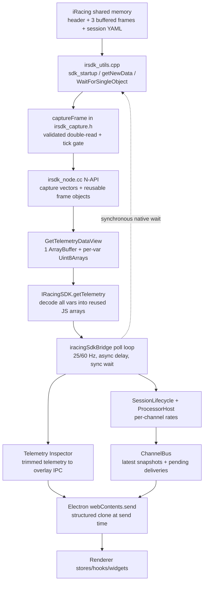

# Deep architecture, correctness and performance audit — iRacing SDK

**Scope:** complete iRacing telemetry path on branch `test-fix-perf` at
`2e2e7059` (local branch, two commits ahead of `origin/test-fix-perf`). Audited
code: shared-memory reader, N-API binding, TypeScript wrapper, iRacing bridge,
processor host/channel bus, Electron IPC, replay/tape infrastructure, existing
performance reports and tests. LMU was reviewed as the sibling simulator source
to avoid recommendations that break the simulator abstraction.

**Date:** 2026-11-19. **Host used for verification:** Linux x86_64, Node
26.13.1, Clang/ASan/UBSan available. No live Windows/iRacing measurement was
made during this audit; Windows evidence is from retained reports listed below.

**Important constraints respected:** no SDK rewrite, no API changes, no
renderer changes, no new dependencies, no production behaviour change, no
commits below branch tip except this report, no merge/rebase/push.

---

## 1. Executive summary

No P0 defect was found: there is no evidence that the SDK corrupts live game
state, crashes the app, or is the dominant cause of player-reported FPS drops.

The most important findings are:

1. **Confirmed — synchronous blocking is in the Electron main thread.**
   `iracingSdkBridge.ts:379` calls `sdk.waitForData(16)` inside the main-process
   poll loop. The native path calls Win32 `WaitForSingleObject(hDataValidEvent,
   timeOut)` (`irsdk_utils.cpp:180-194`) and `Sleep(timeOut)` when disconnected
   (`irsdk_utils.cpp:192`). It can block the main thread for the full 16 ms on
   every poll when no new tick is available. At the demand-driven 60 Hz poll
   rate (`iracingSdkBridge.ts:484-487`) that is up to ~96% of a 16.7 ms cycle;
   at 25 Hz it is up to ~40% of a 40 ms cycle. **Whether this is a meaningful
   end-user bottleneck is not proven:** no retained measurement records wait
   duration, and CPU use of the main process is only ~0.4%.
2. **Confirmed — the SDK telemetry object is a mutable, reused frame, not an
   immutable snapshot.** Numeric arrays are copied in place into arrays cached
   on `IRacingSDK` (`irsdk-node.ts:117-190`, `614-640`). The repository's own
   test asserts that a retained `Speed.value` array changes on the next read
   (`irsdk-node.spec.ts:98-128`). All traced in-tree consumers consume frames
   synchronously; none queues a raw frame past the next read. The contract is
   "valid until the next `getTelemetry()`", and should be documented as such.
3. **Confirmed and reproduced — cached arrays are not truncated or retyped
   when a variable's layout changes.** `copyTelemData()` writes `i <
   srcArray.length` into a reused array (`irsdk-node.ts:151-190`) and never sets
   `targetArray.length = srcArray.length`. A temporary, uncommitted regression
   spec with a 2-element array followed by a 1-element array for the same key
   produced a length-2 result containing a stale tail. The layout-change path
   at `irsdk-node.ts:621-627` clears views and keys but not `_telemetryCache`.
4. **Confirmed — the session YAML is fully transcoded at 2 Hz even when
   unchanged.** Native `GetSessionData()` calls `ConvertToUTF8()` and builds a
   JS string on every call (`irsdk_node.cc:466-481`) while the bridge polls it
   every 500 ms (`iracingSdkBridge.ts:140`, `425-430`). Fixture session JSON
   files are approximately 100-264 KiB (`test-data/*/session.json`), so this is
   roughly 200-600 KiB/s of avoidable short-lived native/JS work in a field of
   that size. Parsing is already memoised in TypeScript
   (`irsdk-node.ts:488-535`).
5. **Confirmed — all telemetry variables are decoded every frame, independent
   of demand.** `getTelemetry()` iterates every key returned by native
   (`irsdk-node.ts:614-640`); the bridge calls it unconditionally
   (`iracingSdkBridge.ts:419-422`). A representative 316-variable fixture has
   2,107 values (~7.8 KiB of raw typed data by variable widths, estimated).
   Static tracing found ~20 directly accessed telemetry keys in processors and
   an upper bound of ~86 named keys anywhere in the processor/lifecycle
   directories. Despite this, **selective decoding is not justified now**:
   measured `processTelemetry` p99 is ~1.3-1.5 ms and main-process CPU ~0.4%,
   and the telemetry inspector, LMU-shared processors and replay fixtures rely
   on broad key availability.
6. **Resolved on this branch — stale native frame views.** The origin version
   reused a frame `ArrayBuffer` based only on its size. Local commits
   `1d93c4bb` and `2e2e7059` add per-variable metadata validation
   (`irsdk_node.cc:605-668`) and a regression test
   (`irsdk-tape-node.spec.ts:347-425`). This was a real hazard when metadata
   changed without changing buffer dimensions; it is fixed here.

Existing game-frame evidence does **not** establish an SDK-caused stutter:
same-session PresentMon controls do not reproduce an aggregate CPU/FPS
regression, and the measured overlay cost is ~1.7% presented FPS with no
>100 ms game intervals (§12). Main-thread blocking, however, remains a
plausible source of *overlay/IPC responsiveness* hiccups in paused, disconnected
or 60 Hz-demand workloads. Establish wait-duration evidence before changing
architecture.

**Recommendation:** Option A — keep the existing architecture, fix the
confirmed correctness/redundant-work issues, and add minimal opt-in wait-duration
instrumentation. If that instrumentation shows material main-thread delay, the
next step should be a dedicated native reader thread with a thread-safe
function (Option D), not a broad telemetry redesign.

---

## 2. Current architecture diagram



Key ownership boundaries:

| Boundary | What crosses | Ownership today |
| --- | --- | --- |
| Shared memory → `irsdk_capture` | Raw frame bytes + var headers | Native-owned vectors, reused each frame |
| `irsdk_capture` → N-API frame | One `ArrayBuffer`, byte views | Persistent native refs; buffer contents mutate in place |
| N-API frame → `IRacingSDK` | Decoded JS arrays | Fresh outer object, reused inner arrays |
| `IRacingSDK` → processors | Same mutable frame object | Synchronous consumption only |
| Processor → `ChannelBus` → renderer | Processor-owned snapshots | Structured-cloned by `webContents.send` at delivery time |

LMU parallels this at the bridge boundary only: `lmuSdkBridge.ts:78-99` uses
8 ms `setTimeout` polling against a 100 Hz writer (measured in that comment),
with 500 ms session polls. Its shared telemetry API is
`IrSdkSourceBridge`/`Telemetry`, so any isolation work must stay behind that
interface and must not assume iRacing-specific tick semantics.

---

## 3. Detailed findings (ranked)

### P0

None. No crash, memory-safety failure, or confirmed user-visible data corruption
was found in the audited revision. Native sanitizer suites pass (§9).

### P1-1 — Synchronous wait executes on the Electron main thread

**Confirmed behaviour; impact partly unverified.**

- `src/app/bridge/iracingSdk/iracingSdkBridge.ts:132` sets
  `WAIT_TIMEOUT = 16`.
- `src/app/bridge/iracingSdk/iracingSdkBridge.ts:377-379` calls
  `sdk.waitForData(WAIT_TIMEOUT)` synchronously at the top of the poll loop.
- `src/app/irsdk/node/irsdk-node.ts:453-460` forwards directly to native and
  only resets session state on version -1.
- `src/app/irsdk/native/irsdk_node.cc:118-151` calls `irsdk_startup()` when
  disconnected and `irsdk_waitForDataReady(timeout, &_capture)`.
- `src/app/irsdk/native/lib/irsdk_utils.cpp:180-194` first polls
  `irsdk_getNewData()`; if no new tick, blocks in
  `WaitForSingleObject(hDataValidEvent, timeOut)`, then polls again. If not
  initialized, it calls `Sleep(timeOut)`.
- `src/app/bridge/iracingSdk/iracingSdkBridge.ts:484-492` raises the poll target
  to 60 Hz whenever a visible subscriber requests 60 Hz and subtracts the
  whole iteration (including the wait) from the delay.

While blocked, the main process cannot service IPC handlers, Chromium messages,
window management, or timers. This is a real architectural property, not a
speculation. But:

- In normal 60 Hz-tick data at a 25 Hz poll, the first non-blocking
  `irsdk_getNewData()` will usually find a newer tick, so the wait is often
  zero. There is no measurement of that distribution.
- Paused replay, disconnected state, and a 60 Hz poll are the cases where the
  full timeout is most likely.
- Main-process CPU is ~0.4% in the full-profile captures (§7): blocking does
  not burn CPU, it consumes wall-clock responsiveness.

See §6 for the blocking-budget arithmetic and §12 for the game-stutter
discussion.

### P1-2 — Telemetry frames are mutable and reused; there are no snapshots

**Confirmed.** The actual ownership contract is:

- `getTelemetry()` allocates a new outer object each call
  (`irsdk-node.ts:618-640`), but `copyTelemData()` reuses cached inner
  `{ value: [...] }` objects and overwrites their elements
  (`irsdk-node.ts:127-190`).
- For `varType === 0` the old implementation would otherwise make a new
  `ArrayBuffer` via `src.value.slice().buffer` (`irsdk-node.ts:133-136`); for
  numeric and bool types, arrays are copied into reusable JS arrays.
- The native data view itself is one reused `ArrayBuffer`
  (`irsdk_node.cc:605-668`), but converted telemetry never retains its byte
  views: `telemetryView()` caches typed-array wrappers only for the duration of
  the decode (`irsdk-node.ts:98-114`), and the arrays handed to consumers are
  JS `number[]`/`boolean[]`.
- `irsdk-node.spec.ts:98-128` explicitly asserts that
  `next.Speed.value === previousValues` and that its contents changed.
- Consumer trace: `ProcessorHost.onFrame()`
  (`src/app/processors/ProcessorHost.ts:324-344`),
  `sessionLifecycle._onTelemetry()`
  (`src/app/sessionLifecycle/sessionLifecycle.ts:226-240`),
  `raceControlBridge.ts:194`, `autoDetectSdkBridge.ts:248-250` and
  `bridgeProxy.ts:89-102` all consume or forward synchronously.
  `bridgeProxy.ts:245-254` stores the latest frame and JSON-serialises it only
  when a new inspector subscriber attaches; no async queue was found holding a
  raw frame past the next read. IPC delivery uses structured clone at send time
  (`src/app/bridge/channelBus.ts:381-389`,
  `src/app/overlayManager.ts:872-895`).

**Consequence:** a future callback that stores a frame in a promise, timer, or
queue will observe later frames. Callbacks are already wrapped in
`createSubscriberNotifier` (`iracingSdkBridge.ts:145-158`) but no ownership
guard exists. Recommended contract: raw frames are valid only for the current
synchronous callback; any asynchronous consumer must copy or receive an
explicit immutable frame. No API change is proposed in this audit.

### P1-3 — Cached arrays are not truncated or retyped on layout change

**Confirmed and reproduced.** In `copyTelemData()` the cached-array path writes
up to the new source length but never truncates the old array
(`irsdk-node.ts:151-190`). The layout-change branch rebuilds keys and clears
`_telemetryViews` but keeps `_telemetryCache`
(`irsdk-node.ts:620-638`). Therefore a variable whose `count` shrinks across a
native layout change leaves stale trailing values, and a variable whose
`varType` changes from numeric to bool reuses an array of the wrong element
history.

Reproduction performed during this audit (temporary spec, run and then
removed; production code untouched):

1. Mock `getTelemetryDataView()` to return a 2-element float array for one key,
   then a 1-element float array for the same key (a new native frame object to
   force the layout branch).
2. Call `IRacingSDK.getTelemetry()` three times.
3. Observed: third frame's `value.length === 2` instead of `1`; index 1 held the
   previous frame's value. No regression test was added because this audit is
   investigation-only; the finding should become a normal test with the fix.

Native cache invalidation itself is sound: `ResetTelemetryCache()`
(`irsdk_node.cc:595-603`) clears both native frame caches, and `WaitForData()`
resets on layout or disconnect (`irsdk_node.cc:126-151`). The gap is entirely
in the TypeScript reuse layer.

### P2-1 — Session YAML is fully transcoded at 2 Hz even when unchanged

**Confirmed behaviour; cost estimated from fixtures.**

- `iracingSdkBridge.ts:425-430` calls `sdk.getSessionData()` every 500 ms.
- `irsdk_node.cc:466-481` reads `irsdk_getSessionInfoStrUpdate()`, refreshes the
  cached pointer only when the version changes, but then *always* runs
  `ConvertToUTF8(session)` and creates a `Napi::String`.
- `ConvertToUTF8()` (`irsdk_node.cc:312-488`) scans the whole string and may
  expand legacy Windows-1252 bytes to UTF-8.
- TypeScript then compares the resulting string with `_sessionInput` and parses
  only on change (`irsdk-node.ts:488-535`).
- The bridge comment at `iracingSdkBridge.ts:135-140` correctly notes that
  `currDataVersion` only refreshes as a side effect of `getSessionData()`, so
  there is currently no cheap pre-check.

Session fixtures in `test-data/*/session.json` range up to ~264 KiB, so a
typical 100-264 KiB string is copied/converted twice per second (~200-600 KiB/s
of short-lived work). This is not per-frame and is not in `processTelemetry`
p99, but it is avoidable and can contribute to GC pressure during driver churn.

### P2-2 — Every variable is decoded on every frame regardless of demand

**Confirmed behaviour.** `getTelemetry()` loops over all native keys
(`irsdk-node.ts:614-640`) and the bridge always calls it
(`iracingSdkBridge.ts:419-422`), even with no widgets subscribed. A recorded
fixture (`test-data/1731641231325/telemetry.json`) contains 316 variables and
2,107 values; using the declared variable widths, that is ~7.8 KiB of raw data
per frame (estimate, not a measured allocation). Static tracing of processors
and lifecycle found ~20 direct telemetry keys and at most ~86 named keys in
those directories (some names are snapshot/config keys, so this is an upper
bound). The inspector allowlist has 78 entries
(`iracingSdkBridge.ts:20-101`, despite the "~60" comment).

At 25 Hz this is roughly 52k JS number writes/s; at 60 Hz roughly 126k/s. In
the captures `sdkTelemetryRead`/`processTelemetry` p99 is ~1.3-1.5 ms and main
CPU ~0.4%, so there is no evidence this is currently a bottleneck. Selective
decoding also has to preserve: telemetry inspector visibility, LMU-shared
processors, replay fixtures, `getTelemetryVariable()`, and future widgets.
Defer until POC measurement shows `sdkTelemetryRead` is material.

### P2-3 — Reconnect may keep a stale mapping view (unverified hypothesis)

`irsdk_startup()` only opens the mapping/event when the corresponding handles
are null (`irsdk_utils.cpp:95-139`). `WaitForData()` on a disconnected SDK does
not call `irsdk_shutdown()`; it only invalidates the capture and resets caches
(`irsdk_node.cc:128-151`). `irsdk_getNewData()` refreshes the heartbeat
whenever the *currently mapped* header still says connected
(`irsdk_utils.cpp:162-177`), and `irsdk_isConnected()` uses that heartbeat
(`irsdk_utils.cpp:195-205`).

If iRacing replaces the named mapping/event on restart, the reader appears to
have no path that reopens the old handles during app lifetime; the app would
need `stopSDK()`/restart. This is supported by code reading only. It is
**unconfirmed** because it depends on whether iRacing reuses the same mapping
object and whether writer shutdown clears the status bit. Existing native tests
simulate capture-level reconnect with a single mapping reader and do not cover
a process-level mapping replacement. Test before assigning priority.

### P2-4 — Windows timer quantization may amplify the 16 ms wait

**Hypothesis.** The file links Winmm "for timeBeginPeriod()" but no
`timeBeginPeriod()` call exists (`irsdk_utils.cpp:52`, `grep` confirms).
LMU's bridge records a measured Windows timer tick of ~15.6 ms and
`setTimeout(16)` delivering ~30.7 ms median (`lmuSdkBridge.ts:78-88`).
`WaitForSingleObject` timeouts are subject to system timer granularity; a 16 ms
request may therefore behave like ~31 ms when the event is not signalled.
That is consistent with the retained event-loop p99 of ~32 ms and 60 Hz-demand
tick rates of ~21-40 Hz (§7), but no measurement attributes those numbers to
`WaitForSingleObject` rather than timers or other main-process work.

### P2-5 — Resolved on this branch: stale native view metadata

Origin branch reused a frame view when only the buffer length matched. Local
commit `1d93c4bb` added per-variable comparisons of `dataSize`, `offset`,
`count`, `type`, `countAsTime`, name, description and unit before reuse
(`irsdk_node.cc:605-668`), plus tests in `irsdk-tape-node.spec.ts:347-425`.
Commit `2e2e7059` fixed the spec's unbound native method binding. This closes
the "metadata changes without changing buffer dimensions" hazard on
`test-fix-perf`; the fix must be preserved in any subsequent refactor.

### P3-1 — Native diagnostics use `printf`

`irsdk_node.cc:70-91, 466-469` and broadcast paths write directly to stdout,
bypassing the project logger. This is low volume (session changes/commands, not
per frame) but can pollute the Electron console and adds avoidable stdio work
during driver churn. No production change proposed here.

### P3-2 — Documentation drift

`iracingSdkBridge.ts:19-20` says the allowlist reduces ~340 keys to "~60"; the
set has 78 entries. Harmless, but update if the file is touched.

---

## 4. Confirmed issues vs hypotheses

| ID | Status | Evidence |
| --- | --- | --- |
| P1-1 sync main-thread wait | **Confirmed behaviour**; bottleneck unmeasured | `iracingSdkBridge.ts:379`, `irsdk_node.cc:118-151`, `irsdk_utils.cpp:180-194` |
| P1-2 mutable frame contract | **Confirmed** | `irsdk-node.ts:117-190,614-640`; `irsdk-node.spec.ts:98-128`; consumer trace |
| P1-3 no truncation/retype on layout change | **Confirmed + reproduced locally** | `irsdk-node.ts:128-190,620-638`; temporary spec run (removed) |
| P2-1 redundant session transcode | **Confirmed** | `irsdk_node.cc:466-481`, `iracingSdkBridge.ts:140,425-430` |
| P2-2 decode-all policy | **Confirmed**; cost estimated | `irsdk-node.ts:614-640`; fixture counts |
| P2-3 stale mapping on reconnect | **Hypothesis** | `irsdk_utils.cpp:95-139,162-205`; no Windows restart test |
| P2-4 timer quantization | **Hypothesis** | `lmuSdkBridge.ts:78-88`; event-loop/tick data, no wait instrumentation |
| P2-5 stale view metadata | **Confirmed and fixed on this branch** | commits `1d93c4bb`, `2e2e7059` |
| Game FPS regression from SDK | **Not established** | PresentMon controls §12 |

---

## 5. Native memory and cache ownership analysis

| Resource | Lifetime | Reuse / invalidation | Assessment |
| --- | --- | --- | --- |
| `hMemMapFile`, `pSharedMem`, `hDataValidEvent` (`irsdk_utils.cpp:44-50`) | Process-wide until `irsdk_shutdown()` | Only opened when handle is null | Read-only view; lifetime safe while app lives. Reopen hypothesis P2-3. |
| `irsdk_capture::data/variables/verifyVariables` (`irsdk_capture.h:13-19`) | Per `iRacingSdkNode` | Resized before each copy; `valid=false` during capture | Bounds checked, double-read verified (§10). |
| Legacy `_telemetryFrame` + per-var `ArrayBuffer` refs (`irsdk_node.h:24-38`) | Until reset | Each buffer memcpy-updated when metadata matches | Copies ~one buffer per variable per frame; not used when data view exists. |
| Data-view `_telemetryDataViewBuffer` (`irsdk_node.cc:605-668`) | Until reset | Single `memcpy` of whole frame when metadata matches | One buffer shared by all views; JS byte views mutate under retained references. Converted telemetry does not retain them. |
| `Napi::ObjectReference` / `Napi::Reference<ArrayBuffer>` | Strong persistent refs | Cleared in `ResetTelemetryCache()` (`irsdk_node.cc:595-603`) | ~316 object refs retained while connected; acceptable but should stay bounded. |
| `IRacingSDK._telemetryCache`, `_telemetryViews`, `_lastRawTelemetry` (`irsdk-node.ts:215-219`) | Per SDK wrapper | Cache reused by array object; views cleared only on raw frame change | Mutable reuse contract (P1-2); truncation bug (P1-3). |
| `ChannelBus.latestSnapshots`/`pending` (`channelBus.ts:183-188,341-389`) | Until replaced/delivered | Processor snapshot object stored by reference | Safe only while processors return immutable/new snapshots; structured clone occurs at send. |
| Renderer IPC | At `webContents.send` | Structured clone | Later mutation of source arrays cannot alter an already-sent message. |

**Answer to "can cached telemetry views become stale when metadata changes
without changing buffer dimensions?":** on `origin/test-fix-perf`, yes; on this
branch, no — native validation was added and is regression-tested (P2-5).

**Answer to "can retained native references observe later mutations?":** raw
`Uint8Array` byte views from `getTelemetryDataView()` share one native buffer
and therefore do see later frames. The `Telemetry` object returned to app code
does not alias that buffer for numeric/bool/string values, but its arrays are
mutated in place (P1-2).

---

## 6. Main-process blocking analysis

Call graph and worst-case budget:

```text
main thread: poll loop
  ├─ sdk.waitForData(16)                     [synchronous N-API]
  │    └─ irsdk_waitForDataReady
  │         ├─ irsdk_getNewData()            [nonblocking read, ~frame size]
  │         ├─ WaitForSingleObject(event,16) [up to 16 ms, possibly quantized]
  │         └─ irsdk_getNewData()
  ├─ sdk.getTelemetry()                      [decode all vars]
  ├─ sdk.getSessionData() every 500 ms       [transcode full YAML]
  ├─ ProcessorHost.onFrame()                 [only due processors]
  ├─ IPC publisher / channel delivery
  └─ await delay(1000/targetHz - elapsed)
```

Scenarios from code:

| Condition | Expected wait behaviour | Main-thread impact |
| --- | --- | --- |
| Connected, new 60 Hz tick, 25 Hz poll | Usually immediate `getNewData()` success | Small; no event wait |
| Connected, no new tick / paused replay | Full 16 ms `WaitForSingleObject` each poll | Up to 40% of a 40 ms cycle |
| Connected, 60 Hz-demand subscriber | Full wait likely on some polls; 16.7 ms cycle | Up to ~96% of cycle in worst case; timer quantization can lengthen period |
| iRacing closed | `startSDK()` attempts + `Sleep(16)` in native, then 1 s retry in bridge | 16 ms per retry attempt, bounded by 1 s retry |
| Stop during wait | `stop()` clears the delay and sets `shouldStop`, but an in-flight native wait cannot be interrupted from JS | Stop may be delayed by at most one timeout, absent other native work |

Can this delay IPC/window/timers? **Yes in principle** — synchronous native
code holds the main thread. No retained measurement demonstrates an actual
dropped IPC message or window-management stall caused by the wait. The event
loop p99 is ~32 ms while `processTelemetry` p99 is ~1.3 ms, which is consistent
with wait/timer-dominated pacing but does not identify the source.

The 5 s running-state `setInterval` at `iracingSdkBridge.ts:333-343` is also
main-thread work but only polls `isRunning()`; it cannot compensate for a
blocked loop.

---

## 7. CPU, allocation and latency measurements

### Retained measurements (not collected by this audit)

| Metric | Value | Source / sample count |
| --- | --- | --- |
| Main-process CPU | 0.4048% / 0.4036% | `docs/performance/2026-11-01-main-full-profile.json`, 2 × 420 s runs, 72 × 10 s reports each |
| App total CPU | 4.483% / 4.604% | same |
| `processTelemetry` p99, mean per interval | 1.305 / 1.350 ms | same; 72 reports each |
| Event-loop delay p99, mean / worst interval | 32.47 / 34.90 ms and 32.44 / 34.47 ms; worst stalls 36.70 / 45.12 ms | same; `resolution: 20` ms in `src/app/perfMetrics.ts:161` |
| Telemetry tick rate | 40.67 / 39.62 Hz | same; mixed 60 Hz-demand profile |
| Event-loop p99 across widget audit | 31.66-32.60 ms; worst stalls 34.57-52.72 ms | `docs/performance/2026-11-14-widget-regressions.json`, 5 runs |
| Tick rate in same audit | 39.1-40.2 Hz in three runs, 21.46 Hz in two | same; likely 60 Hz vs 25 Hz demand, not proven |
| App private-memory slope | +43.68 / +20.32 MiB/min | full-profile report; high variability, not a stable leak estimate |
| Game presented FPS, overlay off/on | 75.17 / 73.89 (1.70% cost) | `docs/performance/2026-11-14-game-stutter.md`, 4 × 420 s PresentMon passes |
| Game intervals >50 ms / >100 ms | 3 / 3 and 0 / 0 across analyzed repeats | same |
| Old/current source controls | 76.53 / 77.07 FPS, CPU 6.178% / 5.902% | same report, 4 × 122 s captures |

Variability is material: private-memory slopes differ by >2× between repeats,
and the widget audit's worst event-loop stall differs by ~18 ms between runs.
Two or five repeats are descriptive, not equivalence tests.

### Estimates and arithmetic (clearly not measurements)

- Raw frame data: ~7.8 KiB for a 316-variable fixture, computed from the
  recorded per-variable `varType`/`value.length` and SDK type widths. The native
  frame buffer is copied at least twice per poll
  (`irsdk_utils.cpp:162-177` → `capture->data`; `irsdk_node.cc:648-651` →
  `frameBuffer`).
- Decoded output: 2,107 JS number/boolean values per frame in that fixture;
  52k/s at 25 Hz, 126k/s at 60 Hz. Cached arrays avoid most steady-state
  allocations but not the write cost.
- Session YAML: ~100-264 KiB from fixture JSON; ~200-600 KiB/s of transcoding
  at 2 Hz, plus a JS string of the same length. Parsing occurs only when the
  text changes.
- Blocking fraction: 16 ms / 40 ms at 25 Hz = 40% worst case; 16 ms / 16.7 ms
  at 60 Hz = 96% worst case. Actual fraction is unmeasured and likely lower in
  normal 25 Hz connected operation.

### Missing measurements

No retained data gives SDK wait duration distribution, `sdkTelemetryRead` cost
separate from `processTelemetry` in the committed JSON summaries, allocation
rate/GC pauses attributable to the SDK, or end-to-end telemetry latency. Those
gaps are why §11 proposes a narrow POC instead of an architecture change.

---

## 8. Architectural alternatives

| Option | Implementation complexity | Event-loop responsiveness | CPU / memory / copies | Latency | Shutdown & reconnect | Ownership | Debug/maintenance | Electron packaging |
| --- | --- | --- | --- | --- | --- | --- | --- | --- |
| **A. Existing synchronous polling** (current) | None | Poor under paused/60 Hz; good when data is ready | Low CPU; 2 frame copies + cached JS arrays; ~316 persistent refs | Immediate publish after wait; timer-quantized cadence | Simple JS stop; wait cannot be interrupted; mapping reopen hypothesis | Ambiguous mutable frame contract | Existing tests/tools | Already packaged |
| **B. Native async N-API reader** (async worker/TSFN per read) | Medium | Good; main thread free while blocking work runs in libuv | Adds per-call task/TSFN overhead and periodic frames; still needs frame copy | One thread hop + queue; likely sub-ms | Must cancel pending workers and own mapping on one thread | Can define immutable frame at JS boundary | Harder: async lifetime bugs; N-API expertise | Same native addon, no extra process |
| **C. Node worker thread** | Medium-high | Good for main thread | Duplicate addon/module state; native globals are process-wide, so two instances are unsafe; extra structured clone | Extra clone + postMessage | Termination must close native handles; reconnect ownership unclear | Frame must be cloned or transferred explicitly | Two JS heaps to debug | Works, but native ABI/rebuild unchanged |
| **D. Dedicated native reader thread + TSFN** | Medium-high | Best; no main-thread wait at all | One native thread, one frame buffer, one copy into JS; bounded memory | Thread wake + TSFN, typically low and more regular | Needs explicit stop/join and single owner of handles/reconnect | Can publish immutable frame objects at boundary | Native debugging, but one clear owner | Same addon; no extra process |
| **E. Separate telemetry process** | High | Good | Extra process + IPC serialization, highest memory overhead | Extra IPC hop | Process supervision, restart, mapping ownership | Clear process boundary | Most complex | Extra packaged binary/lifecycle |

B and D overlap; B is cheaper to prototype but risks repeated worker setup,
whereas D is the cleanest isolation if measurement justifies it. C is the least
attractive because the existing native reader uses process-global handle state
(`irsdk_utils.cpp:44-50`); a second addon instance in a worker would not get an
independent connection. E is disproportionate for a main process using ~0.4%
CPU.

### Architecture decision among A/B/C

- **A — Keep and fix:** recommended now. Measured main CPU and
  `processTelemetry` cost are low; no causal link to game FPS; confirmed
  correctness issues are local and cheap to fix. Opposing evidence: the
  synchronous wait can block main-thread IPC and no wait measurement exists.
- **B — Isolate polling:** justified only if the POC shows wait p99 or event-loop
  p99 materially harms delivery. Risk: async lifetime/reconnect complexity.
- **C — Redesign telemetry service:** not justified. No evidence of a
  throughput or API limitation; high migration cost and LMU compatibility risk.

---

## 9. Tests and verification performed

Executed in this audit on the target branch:

- `npx vitest run --no-coverage` for
  `src/app/irsdk/node/irsdk-node.spec.ts`,
  `src/app/bridge/iracingSdk/iracingSdkBridge.spec.ts`, and
  `src/app/irsdk/native/irsdk-tape-node.spec.ts`: **3 files, 148 tests passed**.
- Clang C++17 with ASan/UBSan for
  `src/app/irsdk/native/tests/irsdk_capture_test.cpp`: **passed** ("Native
  capture safety tests passed").
- Clang C++17 with ASan/UBSan for `irsdk_tape_header_test.cpp` plus tape
  sources: **passed** ("Tape replay header tests passed").
- Temporary cache-reproduction spec: reproduced the stale-tail bug, then
  removed; not committed.

Not executed here: full project suite/lint, Windows native build, live iRacing
or PresentMon captures (Linux host). No test result in this report is claimed
for those.

---

## 10. Capture correctness and lifecycle review

`captureFrame()` (`irsdk_capture.h:116-175`) is careful:

- Validates header version, tick rate, buffer count/length, variable offsets and
  non-overlap (`validLayout`, lines 76-103).
- Reads header, variable metadata and frame bytes with a caller-supplied reader,
  then re-reads metadata/header and requires identical layout, tick count and
  metadata before marking `valid` (lines 147-170).
- Sets `valid=false` before copying and resizes vectors on every attempt,
  avoiding readable partial frames and confusing spare capacity with length
  (lines 145-155).
- Uses a two-attempt retry; torn captures consume no tick (lines 119, 172-174).
- Rejects backward ticks but accepts repeated paused ticks; resynchronises on
  layout replacement at the same tick (lines 133-143).
- `variableRange()` bounds-checks type/count/offset and rejects invalid
  `countAsTime` bytes (`irsdk_capture.h:28-47`).
- Sanitizer tests cover growth/shrinkage, torn metadata, invalid ranges, paused
  frames, backward ticks, reconnect and retry exhaustion (§9).

Lifecycle: `StopSdk()` calls `irsdk_shutdown()`, clears the capture and resets
both native caches (`irsdk_node.cc:107-115`). `WaitForData()` resets on layout
change/disconnect (`irsdk_node.cc:126-151`). Tape seek resets TypeScript
session data (`irsdk-node.ts:462-470`), and replay tests exercise session
versions and malformed descriptors. Shutdown during an in-flight native wait is
not synchronisable from JS; current single-threaded usage limits it to one
timeout, but any future thread design must add join/cancellation semantics.

Session YAML: versions are read in native (`irsdk_node.cc:466-470`); YAML text
is normalised for legacy text fields and unusual driver/team names
(`irsdk-node.ts:250-417`) and parsed with `js-yaml` in JSON mode. Parse errors
are sanitised so user text is not forwarded to logs/analytics
(`irsdk-node.ts:520-558`). Native UTF-8 handling preserves valid sequences and
converts legacy Windows-1252 bytes (`irsdk_node.cc:293-488`), with tests for
Catalan, Spanish, Turkish, four-byte and mixed text
(`irsdk-tape-node.spec.ts:430-470`). No unnecessary *parse* was found; the
unnecessary *transcode* is P2-1.

---

## 11. Minimal proof-of-concept experiment

Goal: determine whether the synchronous wait is a meaningful main-thread issue
before any architecture change. No production behaviour change.

1. Add an **opt-in, perf-run-only** `sdkWait` section around
   `sdk.waitForData(WAIT_TIMEOUT)` at `iracingSdkBridge.ts:379`, reusing
   `TelemetryPerfMetrics.markStart/markEnd` (`src/app/perfMetrics.ts:204-216`).
   Do not enable it in normal launches. Also record the observed `hasNewData`
   ratio and `targetHz`.
2. Reuse `npm run perf:run` with the existing saved-profile benchmark
   (`docs/PERFORMANCE_BENCHMARKS.md`). Run four 420 s workloads with 60 s
   warmup, two repeats each:
   - 25 Hz-only visible widgets (`targetHz = 25`).
   - A visible 60 Hz subscriber (`targetHz = 60`).
   - Paused actual iRacing replay (event not signalled).
   - iRacing closed (retry/`Sleep` path).
3. Keep the existing `eventLoopDelayMs` histogram (20 ms resolution) and CPU/
   tick metrics. Report wait p50/p95/p99/max, wait/tick duty cycle, event-loop
   p99, tick rate, and process CPU with sample counts.
4. Temporary A/B in a private worktree only: rebuild with `WAIT_TIMEOUT = 0`
   (poll-only) and repeat the four workloads. This isolates blocking from
   decode/processing; do not publish this build.
5. Decision thresholds (provisional): if connected-mode wait p99 is <1 ms and
   event-loop/tick metrics do not improve with timeout 0, keep Option A. If
   paused/60 Hz wait p99 is several ms and timeout 0 improves event-loop p99 or
   tick regularity without increasing CPU unacceptably, prototype Option B/D
   behind the existing `INativeSDK` boundary.

This is not an FPS experiment. If a future change is proposed on the basis of
these numbers, repeat PresentMon on/off captures before making any game-stutter
claim.

---

## 12. Could the iRacing SDK contribute to game stutters?

**Short answer:** it can plausibly contribute to *overlay and main-process*
responsiveness hiccups in specific states, but there is no evidence that it is
the dominant cause of player-reported game FPS drops.

**Evidence:**

- Confirmed synchronous main-thread wait (§3 P1-1) can delay Electron IPC and
  timers for up to 16 ms per poll. At 60 Hz demand or paused data, this can be a
  large fraction of the poll cycle. This is a mechanism for overlay stutter,
  not proof of game stutter.
- Main-process CPU is only ~0.4%; `processTelemetry` p99 is ~1.3-1.5 ms
  (§7). The app is not CPU-saturated on the main thread.
- Existing same-session PresentMon controls measured 75.17 vs 73.89 FPS
  overlay off/on (~1.7%) with no >100 ms game intervals, and short old/current
  source controls did not reproduce an aggregate regression
  (`2026-11-14-game-stutter.md`). GPU/DXGI presentation was the larger
  differentiator in the widget audit (`2026-11-14-widget-findings.md`, F10).
- Historical memory/GC findings in `PERFORMANCE_TEST_SUMMARY.md` concern
  renderer payloads and widget state, not the SDK read path.

**Confidence:** moderate that SDK polling is not the primary cause of game FPS
drops in the measured replay workload; low confidence for rare, hardware- or
session-specific stalls.

**Remaining unknowns:** real Windows wait-duration distribution; whether the
16 ms timeout is quantised to ~31 ms; correlation between main-process waits
and renderer animation gaps; behaviour during driver joins / session changes on
real hardware; whether a stale mapping can survive an iRacing process restart;
and player-specific GPU/presentation conditions.

---

## 13. Recommended changes in priority order

1. **Document and enforce the frame ownership contract** (P1-2). Treat a raw
   `Telemetry` frame as valid only during the synchronous callback; copy before
   any async use. Do not change the public API in this work.
2. **Fix `_telemetryCache` layout handling** (P1-3): truncate reused arrays to
   the new source length, reset the cache when `varType` changes, and add the
   regression test described in §3. Small, local, no API change.
3. **Add opt-in wait instrumentation and run the POC** (§11) before considering
   isolation. This is the evidence gate for any architectural change.
4. **Remove the redundant 2 Hz session transcode** (P2-1) when a safe
   native-internal version pre-check can be exposed behind `INativeSDK` as an
   optional implementation detail (not a telemetry API change); preserve YAML
   normalization and legacy-name compatibility.
5. **Investigate reconnect/mapping replacement on Windows** (P2-3) with a
   controlled iRacing restart test; only then decide whether handle lifetime
   needs changing.
6. **Do not implement selective decoding yet** (P2-2). Revisit if wait/decode
   instrumentation shows `sdkTelemetryRead` is a material cost, with an
   explicit compatibility strategy for inspector, LMU and replay.
7. **Keep the native metadata validation fix** (P2-5) and ensure any future
   cache work preserves it.

---

## 14. Acceptance criteria for any future implementation

- No change to `IrSdkSourceBridge`, `INativeSDK`, renderer APIs, or LMU
  behaviour except through the existing simulator abstraction.
- Measured wait and event-loop percentiles are reported with sample counts,
  variability, workload, build hash and baseline; game FPS claims require
  PresentMon, not microbenchmarks.
- No regression in `processTelemetry` p99 (baseline ~1.3-1.5 ms), tick
  regularity, channel delivery rates, or event-loop p99 (baseline ~32 ms in
  the retained replay workload).
- Frame ownership is explicit: raw mutable frames never enter an async queue
  without a copy; immutable-frame changes are tested.
- Layout changes (count shrink/grow, varType change, name/offset change,
  buffer-size-preserving metadata change) have passing native and TypeScript
  regression tests.
- Disconnect, paused replay, seek, reconnect, shutdown during polling and
  demo/replay bridge swaps all release handles and persistent N-API refs,
  with no unbounded memory growth or leaked callbacks.
- Native changes compile in the packaged Electron addon on Windows and pass
  the existing ASan/UBSan capture and tape suites; replay fixtures continue to
  work on Linux.
- Existing safety checks (bounds, pointer checks, torn-read validation, YAML
  error sanitisation) are preserved.
- Full test suite and lint pass before merge; visual PR requirements do not
  apply to this audit, but any UI-adjacent change must follow the repository
  screenshot rules.

---

## References

- `docs/ARCHITECTURE_RULES.md` (hard rules R5, R10, R13, R14)
- `docs/PERFORMANCE_BENCHMARKS.md`, `docs/PERFORMANCE_TEST_SUMMARY.md`,
  `docs/PERFORMANCE_TEST_LOG.md`
- `docs/performance/2026-11-01-main-full-profile.md` and `.json`
- `docs/performance/2026-11-14-game-stutter.md`,
  `docs/performance/2026-11-14-widget-regressions.md`,
  `docs/performance/2026-11-14-widget-findings.md`
- `docs/performance/replay-memory-ownership.md`,
  `docs/TELEMETRY_RECORD_REPLAY.md`, `docs/LMU_RECORD_REPLAY.md`
- `src/app/irsdk/native/tests/README.md`
