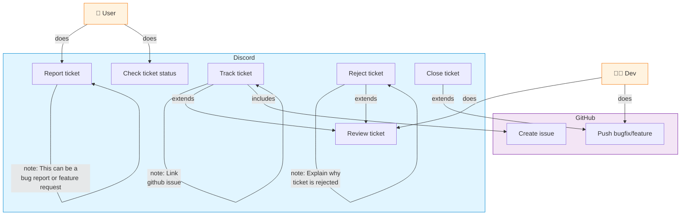

## GitHub notifications in Discord

`.github/workflows/discord-pr-notifications.yml` posts to `#github-logs` when a
pull request is opened or merged. Each card links to the PR and includes its
number, title, author, repository, and target branch. Merged cards also show who
merged it. Opened cards are green; merged cards are purple. Draft PRs and bot
authors are included. Edits, commits, reopens, and unmerged closures are ignored.
Notifications do not ping Discord users or roles.

Configure the repository Actions secret `DISCORD_GITHUB_LOGS_WEBHOOK_URL` with
the Discord webhook URL for `#github-logs` (Channel Settings → Integrations →
Webhooks). Use the standard webhook URL, without the `/github` suffix. Keep the
URL secret: it permits posting to the channel.

The workflow becomes active after it is merged into the default branch and
applies to subsequent events; it does not backfill existing PRs. It uses
`pull_request_target` to support contributors from forks and runs only the
trusted inline notification script. It does not check out or execute PR code,
and the GitHub token has no permissions. PR content is read from the event JSON
and encoded as JSON, never interpolated into executable code.

The existing GitHub-compatible webhook handles forks, releases, and stars
separately. Leave PR events disabled on that webhook to avoid duplicate PR
notifications. To silence forks or stars, deselect those events in the
repository's Settings → Webhooks.
